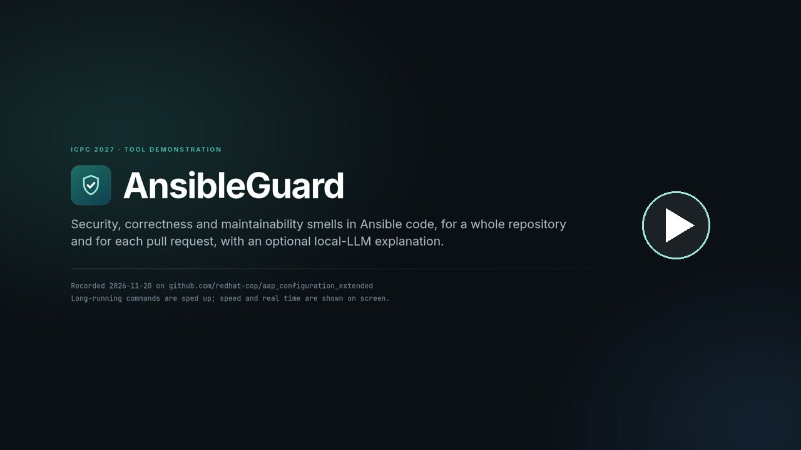

<p align="center">
  
</p>

<h1 align="center">AnsibleGuard</h1>

<p align="center">
  Static analysis for Ansible code: repository scans, pull-request checks and optional local-LLM explanations.
</p>

<p align="center">
  
  
  
  
  
  
</p>

<p align="center">
  <a href="docs/demo/ansibleguard-demo.mp4"></a>
  <br>
  <sub><a href="docs/demo/ansibleguard-demo.mp4">Demo video (4:43)</a> &middot; <a href="docs/demo/README.md">What it shows and how to reproduce it</a></sub>
</p>

---

AnsibleGuard scans a playbook or a whole Ansible repository, combines its own
76 rules with [ansible-lint](https://github.com/ansible/ansible-lint) and
[GitLeaks](https://github.com/gitleaks/gitleaks), and reports one normalized,
deduplicated set of findings as JSON, CSV, text, Markdown and SARIF. In
pull-request mode it compares base and head and reports only what the change
introduced, fixed or moved.

| | |
|---|---|
| **Repository scan** | Security, correctness, maintainability, idempotency, variable, handler and review smells across every YAML file, with overlapping tool reports merged into one occurrence. |
| **Pull-request review** | `ansibleguard diff` matches occurrences between two revisions, applies a ratchet policy that blocks only new problems, and publishes GitHub annotations and SARIF. |
| **Local LLM explanations** | Optional `--explain` through a local [Ollama](https://ollama.com) model. In `verified-facts` mode the model only selects claims certified by the analyzer and cites source lines that are checked against the file. Code never leaves the machine and the model cannot change findings. |
| **Reproducible runs** | Immutable SHAs, source-tree fingerprints, tool versions and the exact rule allowlist are recorded with every result. |

## Contents

- [Quick start](#quick-start)
- [Installation](#installation)
- [Usage](#usage)
- [GitHub Actions](#github-actions)
- [Configuration](#configuration)
- [Detection coverage](#detection-coverage)
- [Output](#output)
- [Development](#development)
- [Limitations](#limitations)
- [Research status](#research-status)
- [Documentation](#documentation)
- [Contributors](#contributors)

## Quick start

```bash
# Scan a repository
ansibleguard path/to/ansible-repo -o results

# Check a pull request: only introduced and fixed findings, ratchet policy
ansibleguard diff path/to/ansible-repo --base main --head feature-branch \
  --profile pr --policy ratchet -o pr-results

# Same comparison with verified local-LLM explanations (requires Ollama)
ansibleguard diff path/to/ansible-repo --base main --head feature-branch \
  --profile pr --policy ratchet -o pr-results \
  --explain --explain-style verified-facts
```

The main outputs are `results/summary/run-summary.md`,
`results/canonical/occurrences.json` and `results/canonical/findings.sarif`,
and for pull requests `pr-results/diff/summary.md` and
`pr-results/diff/comparison.json`.

## Installation

Requirements: Python 3.10 or newer and Git. Internet access is needed once, to
install dependencies, the spaCy model and GitLeaks.

```bash
git clone https://github.com/Narjes-b/AnsibleChecklist.git
cd AnsibleChecklist
python3 -m venv .venv
source .venv/bin/activate
python -m pip install --upgrade pip
python -m pip install -e ".[dev]"
python -m spacy download en_core_web_lg
python -c "import nltk; nltk.download('wordnet')"
ansibleguard install-tools
```

`ansibleguard install-tools` installs GitLeaks; ansible-lint is a regular
Python dependency. Importing the package never downloads binaries.

For local explanations, install [Ollama](https://ollama.com) and pull the
default model: `ollama pull qwen2.5-coder:7b`. See
[study/exploratory-labels/local-llm/SETUP.md](study/exploratory-labels/local-llm/SETUP.md).

## Usage

### Scan

```bash
ansibleguard /path/to/ansible-project                    # whole repository
ansibleguard playbook.yml --output ./analysis-results    # one file
ansibleguard . --profile security                        # one profile
ansibleguard . --fail-on warning                         # exit policy
```

| Profile | Purpose |
|---|---|
| `technical-full` | Every rule, ansible-lint, GitLeaks and Git review checks |
| `developer-fast` | Fast local feedback |
| `security` | Security rules only |
| `lint`, `quality` | Style and maintainability views |
| `pr` | Rules used for pull-request comparison |
| `review-range` | Git review rules over `base...head` |
| `snapshot-source`, `research-core`, `extended-ansible` | Research profiles; require `--file-manifest` |

`--fail-on` accepts `never`, `error` (default), `warning`, `tool-error`,
`parse-error` and `analysis-error`. The default output directory is
`./ansibleguard-output`. The generated
[PROFILE_REFERENCE.generated.md](PROFILE_REFERENCE.generated.md) lists the
exact rules and thresholds of each profile.

### Compare revisions

```bash
ansibleguard diff . --base origin/main                   # working branch vs base
ansibleguard diff . --staged                             # staged commit only
ansibleguard diff . --base <sha> --head <sha> --profile pr --policy ratchet
```

Diff mode reports introduced, fixed and moved findings, changed-line context
and affected playbooks, and writes introduced-only SARIF. With
`--policy ratchet` the exit code is non-zero only when the change introduces a
blocking finding. See [docs/pr-scan.md](docs/pr-scan.md).

### Explain findings with a local model

```bash
ansibleguard diff . --base origin/main --explain --explain-style verified-facts
```

| Option | Default |
|---|---|
| `--explain-style` | `free`; `verified-facts` restricts the model to analyzer-certified claims |
| `--explain-model` | `qwen2.5-coder:7b` |
| `--explain-host` | `http://127.0.0.1:11434` |
| `--explain-timeout`, `--explain-budget` | 120 s per item, 600 s per run |

Every explained finding carries `llm_*` fields: model and digest, contract,
assessment, cited evidence, whether the citations were checked, and duration.
Explanations are labelled as unverified second opinions and never alter the
analyzer result.

### Remote repositories

```bash
ansibleguard github owner/repo --ref develop
ansibleguard github-diff owner/repo --base main --head feature/security
ansibleguard github-pr owner/repo 42 --comment
ansibleguard gitlab group/project --commit abc123
```

Refs are resolved to full SHAs before acquisition. Credentials come from
`GITHUB_TOKEN`/`GH_TOKEN` (or `gh auth token`) and
`GITLAB_TOKEN`/`GL_TOKEN` (or `glab auth token`) and are never written to URLs,
Git configuration, findings or run metadata. Remote sources use a
permission-restricted filesystem cache, with optional Redis for metadata and
locks. See [docs/remote-sources.md](docs/remote-sources.md).

## GitHub Actions

[.github/workflows/ansibleguard.yml](.github/workflows/ansibleguard.yml) runs
on every pull request and push. For a pull request it scans base and head from
detached worktrees, compares them with the ratchet policy, publishes inline
annotations and a job summary, uploads actionable SARIF to code scanning, and
keeps the full evidence bundle as an artifact. Git review rules read
`ANSIBLEGUARD_BASE_SHA` and `ANSIBLEGUARD_HEAD_SHA` when they are set.

## Configuration

Copy the example file into the root of the project being scanned:

```bash
cp .ansibleguard.example.yml .ansibleguard.yml
```

AnsibleGuard searches from each analyzed path toward the filesystem root and
uses the nearest `.ansibleguard.yml`. The configuration can:

- override any legacy `thresholds.csv` value;
- adjust complex-expression, long-line, nesting, and abstraction thresholds;
- define project-specific default credential values;
- add regular expressions for mutating commands;
- declare variables supplied by inventory plugins, CI, or `--extra-vars`;
- supplement installed Ansible metadata with project option deprecations;
- disable findings by stable rule ID.

Every effective configuration is validated before analysis. Invalid YAML,
unknown keys/rule IDs, incorrect types, misspelled thresholds, and invalid
regular expressions stop the scan with exit code 2 instead of silently using
defaults.

Example:

```yaml
thresholds:
  LOC_playbook: 150
  long_statement_length: 140

rules:
  default_credentials: [admin, changeme, company-default]
  additional_mutating_command_patterns:
    - '\bcustomctl\s+apply\b'
  known_variables:
    - deployment_environment
  deprecated_module_options:
    ansible.builtin.example:
      old_option:
        replacement: new_option
        removed_in: "3.0"

suppressions:
  disabled_rules:
    - long-statement
```

Suppressions are applied to the normalized finding list before JSON, CSV,
text, and SARIF are written, keeping those formats consistent. Raw technical
metrics remain available for auditability.

## Detection coverage

The 76 rules are grouped into the following areas:

| Area | Examples |
|---|---|
| Size and complexity | large playbook/play/task, complex expressions, excessive nesting, long statements |
| Modularity and structure | high coupling, missing/empty abstractions, unstructured roles, broken dependencies |
| Naming and cohesion | unnamed plays/tasks, duplicated names, naming punctuation, NLP cohesion |
| Variables and defaults | unguarded variables, unused registered variables, redundant defaults, overriding facts |
| Security | hardcoded/default credentials, credential logging, insecure permissions, disabled TLS validation |
| Reliability | missing handlers, unused handlers, invalid task types, invalid numeric values, silent error suppression |
| Idempotency and modules | non-idempotent commands, shell alternatives, deprecated modules, file extensions |
| Ordering and compatibility | use-before-definition, misplaced role content, deprecated module options |
| Documentation and review | missing tags, unfinished markers, complex-task comments, release notes, bug references |
| External analysis | GitLeaks findings and ansible-lint issues |

For exact algorithms, severity, limitations, and stable IDs, use
[docs/rules/detected-smells.md](docs/rules/detected-smells.md) and
[RULE_REFERENCE.generated.md](RULE_REFERENCE.generated.md).

## Output

Each scan writes a stable directory layout:

```text
ansibleguard-output/
├── summary/      report.json, run-summary.md, summary.csv, diagnostics.json
├── canonical/    occurrences.json/.csv/.txt, findings.sarif
├── raw/          every provider result, including suppressed external findings
├── metadata/     run.json, file-selection.json, review-metrics.json
├── files/        per-file report, findings, occurrences and metrics
└── diff/         after ansibleguard diff: comparison.json, introduced.json,
                  introduced-actionable.json, fixed.json, *.sarif, summary.md
```

- **Raw findings** keep every provider result with its native rule.
- **Canonical occurrences** group overlapping detectors without deleting their
  evidence; SARIF is built from them.
- **Diagnostics** record parse and tool failures separately from code findings,
  so a missing tool is never reported as a clean result.
- **Pull-request bundle**: `introduced.*` keeps all evidence, including optional
  style policy; `introduced-actionable.*` is the risk-first view used for
  GitHub annotations.

Normalized findings share one schema:

```json
{
  "file": "roles/web/tasks/main.yml",
  "line": 12,
  "rule_id": "default-credentials",
  "severity": "error",
  "confidence": "medium",
  "message": "Credential 'password' uses the well-known default value 'admin'.",
  "remediation": "Replace the default credential, rotate it if deployed, and retrieve the replacement from a protected source."
}
```

The full contract, including the legacy 0.0.1 per-file layout, is in
[docs/output-formats.md](docs/output-formats.md).

## Development

```bash
.venv/bin/pytest -q                                                   # 1,696 tests
.venv/bin/python scripts/validate_detector_corpus.py TestData/projects  # detector corpus
```

Rule and profile references are generated
([RULE_REFERENCE.generated.md](RULE_REFERENCE.generated.md),
[PROFILE_REFERENCE.generated.md](PROFILE_REFERENCE.generated.md)) and CI
rejects drift. Package boundaries and call flow are described in
[ARCHITECTURE.md](ARCHITECTURE.md).

```text
src/ansibleguard/
├── cli.py              command line and scan orchestration
├── diff_workflow.py    base/head comparison and policies
├── parser.py           YAML and Ansible structure
├── symbol_index.py     variable, fact and include resolution
├── detectors/          rule implementations
├── external/           ansible-lint and GitLeaks integration
└── report/             JSON, CSV, SARIF, Markdown and LLM explanations
```

## Limitations

- Git review-history rules (`missing-release-note`, `missing-test-update`,
  `untested-override-change`) need a real base revision. On a parentless
  (shallow) snapshot they must not treat the whole repository as the change;
  see [docs/study/v007-audit-2026-10-15.md](docs/study/v007-audit-2026-10-15.md).
- A repository symbol index resolves visible defaults/vars, inventory files,
  play/task vars, facts, registers, loop variables, and static vars includes.
  Dynamic inventory, external secret stores, runtime includes, CI, and
  command-line extra variables remain incomplete; `known_variables` is the
  explicit project escape hatch.
- Handler and role resolution is strongest for visible local files; dynamically
  loaded collections or runtime includes can require project-specific review.
- Fifteen of the paper's 38 checklist criteria are direct matches, eighteen are
  partially automated, and five need reviewer intent that static analysis
  cannot observe.
- ansible-lint loads repository plugins/modules while linting; scan untrusted
  repositories in an isolated environment (see `Dockerfile.research`).

## Research status

The v0.0.7 study scanned a frozen population of 207 GitHub repositories (run
`v007-full-repro-2026`: 390,286 raw findings and 376,115 canonical
occurrences; 171 complete, 35 ansible-lint-partial, 1 timeout). These counts
describe detector output, not confirmed defects. Human validation is at the
calibration-pilot stage on a 144/62 calibration/held-out split, and no v0.0.7
precision or recall estimate exists yet. Earlier estimates belong to their own
versions and are recorded in [CHANGELOG.md](CHANGELOG.md).

The [ICPC 2027 readiness record](docs/study/icpc2027-tool-readiness-2026-11-10.md)
and the [development results](study/icpc2027-development-2026-11-10/README.md)
document the pull-request replay, runtime measurements and the local-LLM
development evaluation, including how each label set was produced.
[docs/study/v007-reproduce-full-run.md](docs/study/v007-reproduce-full-run.md)
reproduces the full run.

## Documentation

| Document | Purpose |
|---|---|
| [docs/README.md](docs/README.md) | Documentation map |
| [docs/how-it-works.md](docs/how-it-works.md) | Pipeline from discovery to reports |
| [docs/commands-and-pr-guide.md](docs/commands-and-pr-guide.md) | Commands, profiles and PR workflow |
| [docs/pr-scan.md](docs/pr-scan.md) | Pull-request comparison |
| [docs/output-formats.md](docs/output-formats.md) | Output layers, schemas, SARIF, severities |
| [docs/rules/detected-smells.md](docs/rules/detected-smells.md) | Rule inventory with algorithms and limitations |
| [docs/rules/smell-catalog.md](docs/rules/smell-catalog.md) | Detailed catalog: purpose, method and complexity of each rule |
| [docs/rules/external-tool-overlap.md](docs/rules/external-tool-overlap.md) | Overlap with ansible-lint and GitLeaks |
| [docs/research/checklist-coverage.md](docs/research/checklist-coverage.md) | Coverage of the 38-criterion review checklist |
| [docs/research/saner24-approach.md](docs/research/saner24-approach.md) | Relation to the SANER 2024 Puppet study |
| [docs/remote-sources.md](docs/remote-sources.md) | GitHub/GitLab acquisition, cache and provenance |
| [docs/study/verified-claims-v82.md](docs/study/verified-claims-v82.md) | Verified-facts explanation mode |
| [docs/demo/README.md](docs/demo/README.md) | Tool demonstration and reproduction commands |
| [CHANGELOG.md](CHANGELOG.md) | Release history |

## Contributors

- Aymen Jedidi ([@JedidiAymen](https://github.com/JedidiAymen))
- Ahmed Amine Essid ([@Daehkcarc-sys](https://github.com/Daehkcarc-sys))
- Narjes Bessghaier ([@Narjes-b](https://github.com/Narjes-b))

## License

No license file is currently included. Add one before redistributing the
project outside the terms agreed by its contributors.
