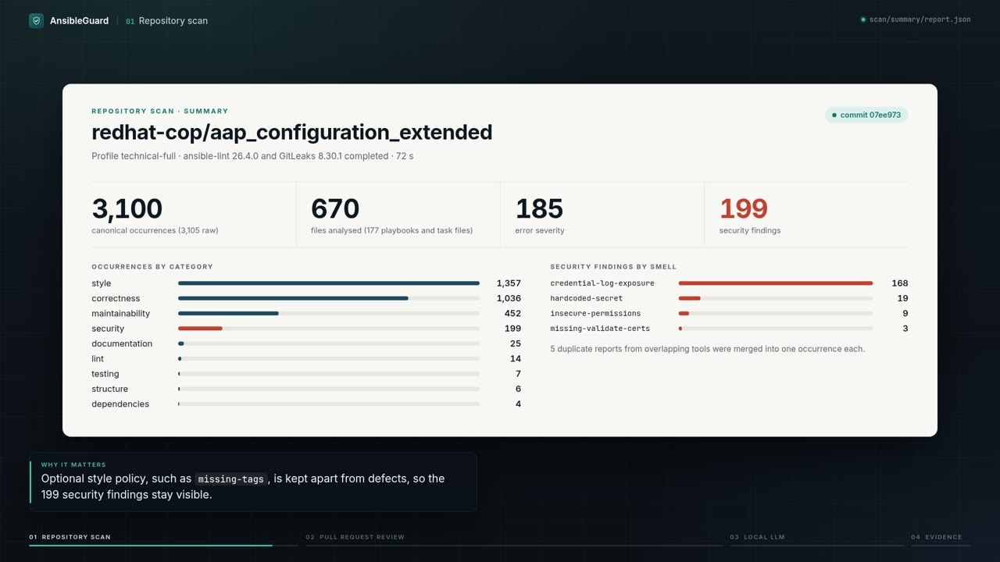

# AnsibleGuard demo (ICPC 2027 tool track)

[ansibleguard-demo.mp4](ansibleguard-demo.mp4): 4:43, 1280x720, captions, no audio.



The video was recorded against the public repository
[redhat-cop/aap_configuration_extended](https://github.com/redhat-cop/aap_configuration_extended).
Every terminal scene is a replay of a real run. Long commands are sped up, and
the speed and the real elapsed time are shown on screen. The only change to the
output is that local paths are shown as `~/demo`.

| Part | What it shows |
|---|---|
| 01 Repository scan | Full scan of the repository (profile `technical-full`, 72 s): 3,100 canonical occurrences in 670 files, with ansible-lint and GitLeaks merged into one result |
| 02 Pull request review | Upstream PR #357 fails the ratchet policy (one introduced `insecure-permissions` finding, exit code 1). Upstream PR #457 passes and fixes a `missing-validate-certs` finding |
| 03 Local LLM | `--explain --explain-style verified-facts` with a local `qwen2.5-coder:7b` model. The model selects backend-checked claims and cites source lines, which are then shown with `git show` |
| 04 Evidence | The same two PRs replayed in GitHub Actions: a failed check with an inline annotation for #357 and a passing check for #457 |

## Reproduce

Requirements: AnsibleGuard installed (see the [main README](../../README.md#installation)),
`jq`, and for part 03 [Ollama](https://ollama.com) with `qwen2.5-coder:7b`.

```bash
git clone -q https://github.com/redhat-cop/aap_configuration_extended.git

# 01 Repository scan
ansibleguard aap_configuration_extended --fail-on never -o scan
jq '.counts.canonical_by_finding_category' scan/summary/report.json
jq -c '.items[] | select(.concept_id=="missing-validate-certs") | {file, line, severity}' \
  scan/canonical/occurrences.json

# 02 Pull request review (upstream PR #357 and PR #457)
ansibleguard diff aap_configuration_extended --base bd6a2dc --head 76dfc3e \
  --profile pr --policy ratchet -o pr357; echo "exit code: $?"
jq '.policy | {conclusion, security_regressions: (.security_regressions|length)}' \
  pr357/diff/comparison.json

ansibleguard diff aap_configuration_extended --base 2526dd1 --head 5d3f20e \
  --profile pr --policy ratchet -o pr457
jq -c '.items[] | {concept_id, file, line, severity}' pr457/diff/fixed.json

# 03 Local LLM explanations
ansibleguard diff aap_configuration_extended --base bd6a2dc --head 76dfc3e \
  --profile pr --policy ratchet -o pr357-llm \
  --explain --explain-style verified-facts --explain-max-items 6
jq '.items[] | select(.concept_id=="insecure-permissions")
    | {llm_model, llm_assessment, llm_explanation, llm_evidence, llm_citations_checked}' \
  pr357-llm/diff/introduced-actionable.json
git -C aap_configuration_extended show 76dfc3e:tests/test_aap_config_vars.yaml | sed -n '73,76p'
```

Results depend on the installed ansible-lint and GitLeaks versions (the
recording used ansible-lint 26.4.0 and GitLeaks 8.30.1) and on the upstream
commit that is checked out. The repository scan used commit `07ee973`.

For CI use, see [.github/workflows/ansibleguard.yml](../../.github/workflows/ansibleguard.yml)
and [docs/pr-scan.md](../pr-scan.md).
