# AnsibleGuard diagnosis and recovery plan — 2026-10-23

Status: proposal for discussion. This pass inspected code and existing evidence; it did not change detectors, labels, frozen manifests, or scan results. **All LLM inference and model evaluation must run locally**, as requested by the owner.

Companion: [machine-readable audit measurements and inspection limits](recovery-audit-2026-10-23.json).

The project has a reproducible detector-output baseline, substantial semantic analysis, and useful calibration material. Its largest gaps are the connection between evidence and judgments, the validity of the final evaluation population, and the consistency of reporting. A model replacement alone will leave those gaps open.

## 1. What this review actually covered

- Current checkout: `a2f9ca6568edba64c392c75ed7c07f57c86eab9c`.
- Full 2026-10-22 report, run manifest, execution tables, determinism report, and the external raw archive at `~/Documents/AnsibleChecklist-results-2026-10-22/v0071-rerun-2026-10-22-results.tar.gz`.
- A census of the archive's 264,704 internal static-source CSV rows, the 107,626 ansible-lint CSV rows for overlap diagnosis, and all 206 repository-root diagnostic files. Inspection of all rows means programmatic aggregation, not independent semantic adjudication of every finding.
- RQ1 pilot agreement, adjudication records, the new blank 400-item forms, the 400- and 352-item exploratory samples, repository split, pilot 2, codebooks and their AI prechecks.
- Threshold results, manifests, existing label fields, and the three large-task pilot rounds.
- RQ2 code and results; PR replay; the variable-resolution calibration review and source-first evidence.
- Both LLM implementations, their prompts, schemas, context assembly, CLI/diff integration, stored outputs, evaluation scripts and scoring records.
- Representative task/play metric walkers, provider aggregation, overlap policy, and relevant CI/package documentation.

This is an evidence-backed backlog, not a claim that every source file has received a complete correctness audit. Historical defect reports are treated as leads when later code may already have fixed them. No scan or live-model evaluation was launched. The existing recorded test pass is 1,227 passed / 2 skipped; this review did not rerun it.

### Baseline we can preserve

| Measurement | Existing evidence |
|---|---:|
| Frozen repositories | 207 |
| Core analyzable repositories | 206 |
| All-provider complete / partial / failed | 171 / 35 / 1 |
| Selected files / selected YAML lines | 31,734 / 1,337,631 |
| All-provider canonical occurrences | 373,923 |
| Occurrences assigned to AnsibleGuard, static source | 264,704 |
| Required / optional within that population | 82,767 / 181,937 |
| Uncertain internal occurrences | 54,196 |
| Uncertain unguarded-variable occurrences | 51,477 |
| Deterministic postprocessing artifacts matching | 46 / 46 |
| Run publication gate | failed; `publication_ready: false` |

These are output counts. `CONFIRMED` currently records a detector's predicate result; it is not a human confirmation that the code contains an actionable defect. Re-aggregation determinism is also narrower than repeat execution of every provider.

Sources: [full run report](v0071-rerun-2026-10-22-full-report.md), [run manifest](../../study/analysis-v0071-rerun-2026-10-22/run/run-manifest.json), [determinism report](../../study/analysis-v0071-rerun-2026-10-22/run/DETERMINISM_REPORT.md).

## 2. Evaluation integrity: resolve this before promising final accuracy

### V1. Screen for prior exposure before selecting the heldout set

Earlier automated labels exposed examples from the original repository split. Record prior exposure and freeze the final evaluation set before inspecting its source contexts for tuning.

Evidence: [repository split](../../study/validation-v007-human/splits/repository-split.csv).

### V2. Pilot precision cannot become the final result just through adjudication

The 350-item pilot manifest says `eligible_for_performance_scoring: false` and defines its purpose as codebook calibration and agreement. Current RQ1 reporting has 119 unresolved semantic disagreements and computes provisional precision from the remaining 231 agreed cases. Its own warning correctly identifies selection toward easier cases. Completing adjudication removes that missing-label problem, but the script then drops “provisional” without checking the pilot's scoring exclusion, sampling design, or development exposure.

**Repair:** retain this as a calibration/agreement report. Adjudicate disagreements to find detector and codebook mechanisms. Build the final estimator around a separate eligible sample and its inclusion probabilities. A report must carry `calibration_only`, `evaluation_eligible`, run identity, codebook hash, label provenance, and adjudication completeness as independent fields. Finality of labels must not imply eligibility for a population accuracy claim.

Evidence: [pilot manifest](../../study/validation-v007-human/samples/agreement-pilot/agreement-pilot-manifest.json), [RQ1 report](../../study/rq1-agreement-pilot/RQ1_RESULTS.md), [RQ1 implementation](../../scripts/rq1_precision.py).

### V3. Three parallel labeling tracks need one explicit decision

The current artifacts include the old 350-item pilot, pilot 2 with 171 items, and newly generated blank 400-item forms. The latter reuse the older v0.0.7 sample from a 127-repository clean subset, including 126 heldout examples, optional findings and older detector behavior. The 352-item sample comes from a different 191-repository reproduction. Neither population is the latest 206-analyzable baseline.

**Repair:** adopt a canonical review-item schema and a label-ingestion command that joins independent forms by stable ID, validates evidence hashes, rejects duplicates or mismatched versions, and preserves both originals. Record the exact run and sampling population. Keep historical samples available for calibration; build new final forms from the selected final population. Preserve probabilities and weights in a private analysis sidecar so reviewers stay blind. Pilot 2 should remain the starting point for instrument repair, subject to V4.

**Done when:** a returned reviewer form can be validated and joined without column renaming by hand, and the report explains exactly which population it estimates.

### V4. Pilot 2 passes structural checks but fails evidence review

Pilot 2 has 171 items covering 55 rules. Four selected items were dropped because frozen source was unavailable. Both human forms remain blank. The manifest records the structural bundle checks. Independent human packet QA is still needed to check redaction, anchors, role and routing context, and evidence for duplicate findings.

**Repair:** translate every flagged mechanism into a packet requirement. Supply computed non-secret facts when decisive literals must be hidden; retain structure and types through redaction. Supply relevant whole constructs, module routing, sibling role/dependency evidence, and both duplicate blocks. Check the predicate is actually defined in the codebook. Rebuild as a new packet version, replenish dropped items with a recorded replacement rule, and perform independent human bundle QA before the agreement round.

**Done when:** semantic packet QA meets the existing ≤5% defect gate; two humans can identify the claimed subject and necessary evidence. A syntactically valid Markdown file is insufficient evidence of that.

Evidence: [pilot 2](../../study/validation-v007-human/pilot2/README.md).

### V5. Record label provenance

Record the producer, labeling method, independence, source evidence, codebook version, and prior exposure for each dataset used in the evaluation.

### V6. Estimators and claims need consolidation

- Equal family samples and square-root rule allocations cannot support an unweighted corpus precision estimate. Family weights alone do not correct unequal sampling within families or context-extraction losses.
- RQ1's family-weighted interval uses an approximate independent-binomial variance; it is not the repository-cluster interval used elsewhere in the same report.
- Carry-over matches use occurrence ID or repository/file/line/rule and report zero ID matches. Locations can contain multiple subjects, and a removed old positive needs regression review. Retained old items alone do not measure precision of a new version that also adds findings.
- Existing “uncertain bounds” omit unreviewable items and pending adjudication. State the covered denominator and report reviewability separately; include sensitivity bounds for all unresolved eligible items when making a population claim.
- The variable-resolution study already contains single-agent calibration recall (10/11 supported occurrences). Documents saying no recall work exists are stale. It remains insufficient for independent final recall or overall F1.
- RQ numbering conflicts: one plan calls policy conformance RQ2, while current paper outputs use RQ2 for co-occurrence.

**Repair:** write one claim/estimand registry. For each claim record population, rule set, unit, sampling design, weights, missingness, label policy, estimator, interval, exclusion criteria and analysis version. Use design-aware estimates and repository-level resampling; validate interval behavior in the existing simulation framework. Preserve exploratory results with explicit scope. Source-first recall needs independent audits of both flagged and unflagged source, plus adjudicated matches; seeded recall and external-tool agreement are separate instruments.

Evidence: [validation plan](v007-validation-plan-v2.md), [variable calibration report](../../study/validation-v007-variable-resolution/VALIDATION_REPORT.md), [performance narrative](tool-performance-report.md).

## 3. LLM recovery: a local evidence pipeline

### Concrete implementation defects and gaps

| ID | Finding in current code | Repair |
|---|---|---|
| L1 | Required fields assume a defect and a fix: `what_is_wrong`, `why_it_is_wrong`, `recommended_fix`. There is no structured unsupported/unknown decision. | Add an explicit assessment and require evidence or an abstention before generating remediation. |
| L2 | Main source context is only ±6 lines, regardless of rule. | Retrieve complete AST constructs and rule-specific evidence with source spans. |
| L3 | Cross-file lookup takes the first three repo-wide definitions; it does not establish reachability, ordering, precedence or unconditional availability. The prompt even treats plausible reachability as enough to call a false positive. | Export deterministic `must`/`may` visibility, guards and blockers. A possible definition supports uncertainty, not proof of safety. |
| L4 | Context omits existing occurrence certainty, resolution evidence, uncertainty sources and much of the rule predicate. | Include typed detector evidence, predicate/threshold/version, and explicit missing inputs. |
| L5 | Graph construction is repeated independently of the scan and cached globally by root path only. | Pass the scan's graph/context; key reusable caches by snapshot, selection, config and analyzer identity; bound lifetime and size. |
| L6 | Definition-line repair searches for a substring in the next 30 lines; stale anchors are silently clamped to EOF. | Fix source spans in the index; verify the asserted subject at the span. Mark stale evidence invalid and retrieve from the correct snapshot. |
| L7 | `diff --head` removes its temporary head worktree before explanation, then reads context from the current checkout. Staged explanations similarly read the working tree. | Generate context from the exact head/index snapshot while it is alive, or from verified immutable source blobs. |
| L8 | `_validate` only checks JSON object and key presence; it accepts wrong types, invalid confidence values and empty or inconsistent fields. | Enforce the whole local schema and cross-field invariants after generation. |
| L9 | Requests have no explicit output-token budget; returned `done_reason`, token counts and useful runtime metadata are discarded. | Bound generation, record completion/truncation, prompt/generated tokens, load/inference timings and server/model identity. |
| L10 | Calls run sequentially, with up to 120 seconds per item, no finite default item cap and no run budget or failure circuit breaker. Reporting waits for enrichment. | Persist core results first. Use a separate resumable explanation stage, bounded selection, a batch budget and explicit skipped reasons. |
| L11 | Current integration has no complete audit record with prompt hash, context hash, model digest, exact options and response. The experimental script stores more, but is a different path. | Use one production module, one evaluation adapter and one versioned audit contract. |
| L12 | Raw source is interpolated into prompts without the bundle redaction/scoping checks; `--explain-host` can target a remote server. | For the local-only requirement, enforce loopback/local transport, validate paths under the snapshot, redact input/output and treat source comments as data. |
| L13 | Evaluation scans an existing output directory and returns success despite per-case failures; scores are inserted by a static per-ID scoring script. | Use isolated run manifests, explicit case inventories, failure counts and independently attributed scoring records. Old scores cannot be reapplied to new responses. |
| L14 | Model name/tag is treated as sufficient reproducibility; prompt copies and disclaimers have drifted. | Pin the model digest/quantization and server version; hash prompt/schema/context builders; render the actual evidence scope. |

Code: [integrated explainer](../../src/ansibleguard/report/llm_explain.py) and [diff snapshot lifecycle](../../src/ansibleguard/cli.py).

The local-only policy should be enforced at the transport boundary; any stronger process-level offline guarantee can be supplied by the local runtime's network isolation. Running on localhost alone does not redact sensitive values or make historical snippets safe to publish.

### Proposed architecture and contract

```mermaid
flowchart LR
    A[Exact source snapshot] --> B[Parser and semantic graph]
    B --> C[Detector occurrence and proof state]
    C --> D[Rule-specific evidence packet]
    D --> E[Scope, completeness and redaction checks]
    E --> F[Local model assessment]
    F --> G[Schema and evidence-reference validation]
    G --> H[Explanation or explicit abstention]
    H --> I[Separate audited report enrichment]
```



The packet should include:

- Repository/snapshot identity, selected population, config and analyzer versions.
- Rule predicate, measured values, threshold comparator, applicability and target Ansible version.
- Subject and complete source construct with stable evidence IDs and verified line spans.
- Definitions and uses, import/include/call-site edges, guards, ordering, handlers/listeners or module metadata relevant to this rule.
- Distinct `must`, `may`, unreachable and unknown evidence, with a reason for every unresolved edge.
- Completeness fields: required evidence found/missing, truncation, external runtime inputs, redaction effects and token budget.

Use this response shape as a proposal:

```json
{
  "assessment": "supported | contradicted | insufficient_evidence | policy_dependent",
  "summary": "short statement limited to the evidence",
  "evidence_ids": ["E1", "E2"],
  "missing_evidence": [],
  "suggested_change": null,
  "patch_candidate": null,
  "limitations": []
}
```

Application rules must enforce the contract. Insufficient evidence produces a request for specific context and no patch. Contradicting evidence produces an explanation of why the reported defect is unsupported and no unnecessary fix. Policy-dependent advice names its policy. A model's disagreement remains an audited second opinion; suppressing or reclassifying the detector occurrence is a separate validated code decision. A present definition alone does not prove it executes before the use.

Separate evidence completeness from measured model reliability. Remove self-reported high/medium/low confidence from ranking until its relationship with correctness has been evaluated. A cited line can be checked for existence and exact content; that check alone does not establish that the inference is correct.

Ollama supports supplying a JSON schema and validating responses locally; that provides a useful shape contract, while semantic correctness still requires the evaluation above. Its chat API exposes completion reasons and token/timing data that the current client discards. Sources: [structured outputs](https://docs.ollama.com/capabilities/structured-outputs), [chat API](https://docs.ollama.com/api/chat).

### Local model evaluation before model selection

1. Preserve the present 12 cases as development regressions. Re-adjudicate disputed examples against the exact codebook and source; do not silently promote old reviewer agreement to gold.
2. Build approximately 100–150 development cases balanced across rule families, true findings, false alarms, policy cases and deliberately insufficient evidence. Include conditional definitions, imports, same-name variables in unrelated roles, dynamic includes, registered values, handlers, templated booleans, no-log behavior, shell guards, non-Ansible YAML, empty/stale context and misleading source comments.
3. Reserve a separate unseen evaluation set before prompt/model tuning, with duplicate and repository exposure checks. Two reviewers score validity and remediation; adjudicate disagreement. This explainer set and the detector's final research set need explicit separate purposes.
4. Compare: deterministic rule templates; current 7B with current context; the same 7B with repaired evidence and decision schema; one or two locally runnable alternatives with the identical repaired packet. This separates context improvements from model capability.
5. Record decision correctness, false-confirmation rate on negatives, abstention behavior, evidence support, harmful recommendations, patch validity where relevant, review effort, p50/p95 latency, peak memory and failure rates. Report coverage with quality and intervals. A system that abstains on everything has zero usefulness even if it avoids false claims.
6. Verify local hardware and feasible quantizations before downloading alternatives. The historical 8 GB RTX 5060/Windows measurement belongs to a previous environment; this session's `nvidia-smi` could not communicate with a driver. No reliable current GPU capacity was established.

**Proposed shipping gate for discussion:** all historical critical regression cases correct or safely abstained; no destructive/semantics-changing recommendation on the critical negative cases; ≥90% acceptable explanations among answered cases on the independent set, with interval and minimum coverage reported; ≥95% schema/completion success; explicit local resource budget. These are engineering acceptance proposals, not existing achieved results or published precision targets. If no model clears the gate, ship templates for validated families and keep model explanations experimental. Fine-tuning and general repository vector search should wait for evidence that simpler scoped packets leave a specific remaining problem.

## 4. Detector and evidence repair priorities

### D1. Unify traversal and measurement units

Current `large_task.analyser_play` visits `tasks` but not `pre_tasks` or `post_tasks`. The play metric walker stops after the first nested `block`/`rescue`/`always` branch, so sibling branches are omitted. The task walker also counts a top-level container after visiting its children when `include_container=True`, while nested containers are skipped. Existing pre/post tests cover other rules and do not establish metric consistency here.

Task/play LOC is produced by dumping YAML, while playbook size includes physical source/comment lines. That may be an intentional metric, but the names and thresholds must specify it. Reformatting or serialization behavior can otherwise appear as a meaningful size difference.

**Repair:** define one parsed task iterator and one metric contract: executable leaves, containers, all task sections, handlers, rescue/always, multi-document YAML and source spans. Define physical lines, non-comment lines and canonical serialization size as separate quantities if needed. Evaluate consequences before migrating thresholds. A metric-definition change requires a new benchmark version and result delta.

Code: [task metrics](../../src/ansibleguard/detectors/large_task.py), [play metrics](../../src/ansibleguard/detectors/detect_large_play.py), [playbook metrics](../../src/ansibleguard/detectors/detect_large_playbook.py).

### D2. Work through false-positive mechanisms, not report totals

Priority order should combine risk, affected volume, reviewability and confidence in the mechanism:

| Area | Evidence/problem to resolve | Concrete repair task |
|---|---|---|
| Non-Ansible YAML | Samples report Kubernetes patches, Go Taskfiles and webhook/data YAML treated as Ansible. Current sample findings include operator config paths. | Audit manifest classification and runtime applicability together. Explicitly label file kind; apply task rules only to eligible constructs. Measure rejected true Ansible examples as well as removed false alarms. |
| Variable reasoning | 51,477 uncertain unguarded-variable occurrences; external/runtime input dominates. | Separate undeclared input contracts from genuine missing definitions; carry guards, required role inputs, inventory/runtime sources and must/may execution evidence. Quantify resolution coverage without calling unknowns bugs. |
| Security/logging | Current code already includes argument metadata and some inherited/dynamic no-log handling; old “not implemented” notes are stale. | Audit installed metadata coverage, aliases, placeholders versus paths, inherited and overridden no-log, register/display chains and cross-file displays. Do not infer safety merely from a default that can be overridden. |
| Command behavior | Guarded commands, read-only probes, mutation in pipelines and heredoc scope drove earlier errors. | Define per-rule predicates for mutation, changed reporting and idempotence. Review introduced as well as removed findings; maintain a mechanism-level calibration set. |
| Handlers/registers | Cross-file availability and use cannot be settled by local text absence. | Share the execution/notification graph, include `listen`, imports, conditional paths and declared external inputs. Audit suppression safety as well as emitted precision. |
| Anchors/subjects | Historical context has line 1 anchors, missing variable names, and complex-expression mismatches. | Require subject, construct span and measured evidence in every reviewable occurrence. Retain unknown source span explicitly. |
| Duplication | A sample notes duplicate-name `count=1`; its meaning could be one duplicate group or extra occurrence. | Establish count semantics before treating this as a logical bug. Emit member spans and duplicate groups instead of an ambiguous count. |
| Version/policy | Legacy loops, module redirects, valid templated attributes and broad-become thresholds mix policy with semantics. | Pin target semantics; expose policy and evidence predicates; validate actual defect/actionability separately. |


### D3. Improve the developer-facing decision

Optional output is 68.7% of the baseline; five rules produce 74.7% of assigned AnsibleGuard source occurrences. This is an alert-volume and interpretation problem even if policy predicates are implemented exactly.

Use validated required rules for the primary decision, grouped or summarized policy findings for optional review, and a separate uncertainty queue. Rank by risk and supported actionability. Keep detector certainty, label agreement, model confidence and publication maturity distinct. Audit zero-hit, disabled, profile-excluded and unvalidated catalog rules separately; “76 catalog entries” is not a statement that all 76 ran and were validated.

## 5. Threshold calibration needs a new frozen version

Two small artifacts currently disagree with `benchmark-manifest.json`: `LABELING_CODEBOOK.md` **and** `large-task-agreement-pilot.csv`. The documented run exception mentions only the first. The later commit records revisions after rounds 1–3; these are explainable changes that still invalidate the old hashes.

All three large-task rounds contain the **same 75 observation IDs**. Recorded κ is 0.637, 0.635 and 0.754 against the threshold pilot target of 0.80; each status still says to refine and run a new pilot. There are real paired labels in the pilot CSVs, although summary documents and generic status files say zero independent labels. The primary `*-labels.csv` ledgers remain unfilled. The distinction between pilot rounds, primary labels, reviewer provenance and adjudication is currently too easy to lose.

**Repair sequence:**

1. Preserve the old benchmark as a historical version and explain its modifications. Freeze a new codebook/benchmark manifest with separate immutable evidence and mutable reviewer ledgers.
2. Record who made each round and under which codebook; determine whether judgments were independent. Repeated items under revised instructions are calibration evidence.
3. Select fresh pilot examples with adequate positives and borderline cases. Retain the predeclared target and report κ, AC1 and per-label agreement together. Do not lower the gate after seeing results.
4. Resolve inactive legacy keys (`avg_task_playbook`, `similarityPlays`) through an explicit metric/predicate decision. Audit actual production sensitivity before labeling them.
5. Prioritize a manageable set of impactful metrics: large-task, complex-expression, large-playbook, missing-abstraction and undocumented-complex-task. Tie labels to operational definitions and complete contexts.
6. Use banded source-first labels and the existing weights to compare candidate thresholds, then evaluate composite rules as whole predicates. Quantiles describe the corpus; they do not establish useful thresholds.
7. Rebuild observations when metric/traversal semantics change. Publish a checksum-addressed retrieval path for large observations and raw archives so a fresh checkout can reproduce the gate.

Sources: [threshold results](../../study/threshold-benchmark-v007/RESULTS.md), [round 3 status](../../study/threshold-benchmark-v007/large-task-agreement-pilot-round3-status.json), [inventory](../../study/threshold-benchmark-v007/COMPLETE_THRESHOLD_INVENTORY.md).

## 6. Execution, provider comparison and reproducibility

### E1. Diagnose the repeated timeout before raising limits again

`encapsulate-xyz/cosmos-ansible` repeatedly fails at 1,800 seconds; an earlier variable-resolution run also failed at 3,600 seconds. Its archived scan log is empty, so the archive does not identify the stalled stage. A specific detector/provider cannot responsibly be blamed yet.

**Repair:** reproduce this repository alone under the same frozen inputs; emit unbuffered stage start/end events and heartbeat/stack diagnostics; time acquisition, metadata, graph construction, external providers and each file/detector separately. Bound expensive stages and preserve completed provider results under explicit partial status. Identify the mechanism, fix it, and rerun the focused case before a full population run. Keep the repository in the population with explicit missingness until resolved.

### E2. Turn 35 partial provider states into an actionable failure ledger

The 206 repository-root diagnostic files contain 440 ansible-lint provider-error entries across the same 35 partial repositories. These entries can include nested root evidence and are not 440 independent failing repositories. They include 423 `internal-error`/syntax-check diagnostic entries, invalid legacy project configurations, and invalid-JSON/provider failures. One concrete configuration rejects the old `parseable` key. Several exceptions arise during dependency/plugin/syntax-check processing.

**Repair:** store repository, provider root, selected files, exact command/environment, project config hash, required collections/roles, failure class and retry decision. Distinguish invalid target code, incompatible project config, missing dependencies, provider bugs and infrastructure timeouts. Decide whether the comparison measures project-native lint policy or a standardized research policy; use new run IDs for changes. Lock the needed dependency environment without executing target playbooks. Any diagnostic-only mocks or config adaptations must be declared as their own protocol. Preserve the workspace guard.

The official linter requires correct project-root execution and documents how configuration and CLI values combine: [configuration reference](https://docs.ansible.com/projects/lint/configuring/).

### E3. Snapshot review counts have restricted history coverage

176 of 206 core-complete repository diagnostic files say diff-dependent review rules were not evaluated because a parent is missing. Their absence is not a clean review result. Pilot 2's review family is 20 commit-message items out of 24 and therefore does not exercise the other review rules evenly.

**Repair:** use source-only profiles for snapshot claims; report message/history coverage separately by rule and actual comparable range. Fetch verified parent trees into side caches where needed, then validate on a stratified PR replay. The existing 21-PR replay establishes useful attribution behavior on its selected cases; its 46 introduced / 7 fixed findings still need independent semantic/actionability review for defect-quality claims.

### E4. Provider counting definitions need explicit names

The 264,704 source total is a canonical-provider allocation. It excludes AnsibleGuard native evidence merged into an occurrence assigned to another provider. The overlap script instead includes native-rule membership. These are different quantities.

For example, on the 171 complete repositories, non-idempotent-command has 453 internally assigned rows plus 530 rows carrying its evidence under ansible-lint, yielding 983 native-supported occurrences. Thus 983 versus the full-report 708 internally assigned occurrences is **not by itself a double-counting proof**. Reports need both views, with matching denominators, and must state which drives sampling, rule coverage and weighting.

**Repair:** build a canonical occurrence table and a normalized provider/native-rule evidence table keyed by run, repository, source SHA and occurrence. Publish allocated canonical counts, native-supported counts and shared-evidence counts explicitly. Retain semantic subjects and structured context in study adapters; the aggregate CSV currently drops `semantic_subject`, so it cannot directly reproduce integrated variable-context lookup.

### E5. The new overlap script has a confirmed cross-repository ID bug

`compare_with_ansible_lint.py` keys `merged` and `matched_al` by CSV filename plus occurrence ID, omitting repository identity. Occurrence IDs repeat across repositories sharing file content/locations. Recomputing intersections using repository/file/line gives:

| Pair | Published ansible-lint-only | Repository-scoped same-line result |
|---|---:|---:|
| non-idempotent-command / no-changed-when | 3,188 | 3,187 |
| unnamed-task / name[missing] | 751 | 736 |

These corrected intersections still implement the existing same-line policy; they do not establish equivalent semantics or recall. Several pairs are partial overlaps: no-changed-when is about changed-state reporting, and no-log-password specifically addresses password loops and is opt-in. Its zero count cannot be interpreted as zero detection capability without checking activation and eligibility. There are nine pairs in the CSV despite the commit description saying eight.

**Repair:** use repository/SHA-scoped IDs; match by verified construct/subject with one-to-one accounting; declare exact/subset/overlapping predicates and configurations; report matched, unmatched and ambiguous cases. Require totals to reconcile. Report pair-specific enabled/eligible populations. Human-review tool-only examples before describing them as added coverage or false negatives.

Code: [comparison script](../../scripts/compare_with_ansible_lint.py), [published pairs](../../study/ansible-lint-comparison-v0071-rerun-2026-10-22/rule-pairs.csv). Semantic references: [no-changed-when](https://docs.ansible.com/projects/lint/rules/no-changed-when/), [no-log-password](https://docs.ansible.com/projects/lint/rules/no-log-password/).

### E6. Protect the reproducibility contract

Preserve frozen archives and recorded hashes. Add an artifact index covering run ID, tool/source/environment identities, archive hash, size, location, supersession and publication status. Separate file integrity, execution completeness, provider coverage and label validity; a gate should state which claim each failure blocks. Restore threshold integrity through a new version, then require supported gates for the next run. Record any deviation with its scope. Historical postprocessing should remain identifiable as such.

Dependency declarations permit broad versions while the experiment uses a pinned environment. Treat those as separate installation and research contracts. Check supported Python/dependency combinations and environment identity in the next implementation validation; avoid assuming a fresh editable install reproduces the frozen run.

## 7. RQ2 needs an inferential review before paper claims

The current RQ2 correctly includes zero-finding files and controls file size. It is useful exploratory detector-output analysis. Remaining issues visible in the implementation:

- File-level tests use 31,734 files as transactions without repository-cluster inference. Shared repository conventions and copied roles can drive associations.
- Five LOC strata leave residual size differences; equal-rank stratification splits tied sizes by ordering. Rule applicability/file kind can also confound pairs.
- Rules share metrics and predicates, including across review families. Cross-family membership alone does not establish independence of their definitions.
- “Explained by file size” is stronger than “no longer supported after this adjustment.” Non-significance alone does not prove an explanation.
- Joint co-occurrence filtering precedes significance correction. Define the tested hypothesis family and the support filter before interpreting q-values; inspect sparse/nested tables and heterogeneity.
- Default/all-rule associations mix policy output and uncertain findings with supported required findings.

**Repair:** preregister an eligible-rule/pair population; report descriptive support/lift separately from inferential associations; use repository-cluster bootstrap or appropriate blocked permutation, eligibility/file-kind controls, size sensitivity, and leave-one-large-repository/duplicate-role sensitivity. Tag mathematical/predicate overlap. Evaluate required, optional and uncertain populations separately. Recompute after the final detector freeze and describe associations of detector outputs until validated-defect evidence supports a stronger claim.

Evidence: [RQ2 implementation](../../scripts/rq2_cooccurrence.py), [current results](../../study/rq2-v0071-rerun-2026-10-22/RQ2_RESULTS.md).

## 8. Delivery sequence, dependencies and acceptance gates

Effort below is a planning range for focused engineering days, excluding reviewer scheduling and unknown timeout complexity. It is not a fixed delivery promise. Existing validation planning estimates roughly 135 reviewer-hours for its 867-item main design; scope should be chosen before assigning that workload.

| Stage | Work and deliverables | Depends on | Exit gate | Effort |
|---|---|---|---|---|
| 0 — Establish trustworthy status | Artifact/provenance/exposure ledger; claim/RQ registry; identify calibration versus eligible evaluation data; mark superseded status pages. | This audit | One consistent run/population/label status; evaluation claims justified. | 1–2 days |
| 1 — Repair evidence | Canonical review schema and form adapter; correct subject/source spans; shared task traversal; rule-specific packets; redaction facts; immutable head/index context. | Stage 0 decisions | Every item identifies its claim and evidence; fresh packet QA meets ≤5% defect gate. | 3–6 days |
| 2 — Repair execution and comparisons | Timeout instrumentation and focused diagnosis; provider failure ledger; repository-scoped overlap IDs; canonical/native count views. | Stage 0 | Focused failures explained/resolved; matching totals reconcile; coverage is explicit. | 2–5 days, timeout uncertain |
| 3 — Repair priority detectors | Classification, variables, commands, security, handlers; validate source spans and suppression safety; migrate metric definitions under a new version. | Stages 1–2 | Each change has an independently checked calibration mechanism and before/after error analysis, including lost true positives. | 4–8 days |
| 4 — Rebuild local LLM | One module/adapter; assessment schema; proof-aware packets; bounded offline runtime; audit records and failure accounting; compare local candidates. | Stage 1 and stable rule predicates | Independent explanation evaluation meets agreed quality/coverage/runtime gates. | 3–6 days plus scoring |
| 5 — Calibrate instrument and thresholds | Fresh pilot 2 successor; fresh threshold pilots; two independent humans; codebook fixes; freeze identities and sign-off record. | Stages 1 and 3 | Existing predeclared family/threshold gates satisfied or failing rules/families excluded from claims. | 2–4 days preparation plus reviews |
| 6 — Final freeze and validation | New version/run; checksums; final eligible sample; independent labels/adjudication; source-first recall and PR semantic checks; uncertainty sensitivity. | Stages 0–5 | No development tuning on final labels; design-aware estimates and intervals; explicit limits and missingness. | 2–4 days preparation plus reviews/run |
| 7 — Paper and release | Regenerate status, results and charts; RQ2 sensitivity; rule maturity/profile decisions; local LLM status; artifact release index. | Stage 6 | Every reported claim links to the correct run, eligible sample and analysis; no provisional statistic presented as final. | 1–3 days |

Stages 1 and 2 can proceed independently after the evaluation decisions. Stage 4 can use repaired packets while detector work continues on other families, but its final evaluation must use frozen predicates. A full 207-repository run should follow focused diagnosis and repairs; repeated full runs do not resolve unknown failure mechanisms.

### First implementation batch I recommend

1. Add the status/exposure/provenance registry and make performance-report eligibility explicit.
2. Repair repository-scoped overlap accounting and distinguish native versus allocated counts.
3. Fix exact-source explanation for head/staged comparisons, strict response validation, and missing-evidence abstention.
4. Unify task/play traversal and source-span reporting; version affected metrics.
5. Rebuild a small set of representative packets spanning variables, security, handlers and size rules; independently review them before expanding labeling.
6. Diagnose the one timeout and classify the 35 partial-provider mechanisms.

The strongest next milestone is: **every reported finding and explanation has traceable evidence, every unresolved case is represented honestly, and the final evaluation population has a defensible independence story.** That milestone makes later model selection, precision estimates and paper writing substantially more reliable.

## 9. Decisions to settle during discussion

1. Final evaluation scope: a new frozen repository set is the recommended route if development exposure cannot be excluded; the existing corpus remains valuable replication/calibration evidence.
2. Initial supported rule families: prioritize objective/security cases with complete evidence and measure variable-resolution coverage separately. A broad catalog can remain available with explicit validation maturity.
3. LLM role: evidence-grounded explanation with explicit abstention and optional reviewed patch candidates. All execution stays local. Hardware discovery precedes selecting larger alternatives.
4. Human effort: name the independent packet reviewers, labelers and adjudicator; choose which final claims fit the available hours. The earlier non-author sign-off decision is already settled in the validation plan; record it rather than reopening it.
5. Publication scope: final detector precision and supported recall require new completed evidence; co-occurrence can be reported descriptively with its stated limitations while that work proceeds.

The proposed order does not require discarding the current results. It requires keeping each result attached to the claim its design and provenance can support.
