# Full results report: run `v0071-rerun-2026-10-22`

Complete results of the AnsibleGuard full study run over the frozen 207-repository corpus. Every number below is read from the run's own tables by `scripts/build_run_results_report.py`. **All counts are detector output, not validated defects**: no precision estimate exists yet, so no count here is a claim that a defect exists.

Short summary, deviations and comparison: [v0071-rerun-2026-10-22-summary.md](v0071-rerun-2026-10-22-summary.md).

## Key results

- 207 frozen repositories: 171 complete, 35 partial (ansible-lint incomplete), 1 failed (timeout); 206 are analyzable for AnsibleGuard (1,337,631 selected YAML lines in 31,734 files).
- AnsibleGuard reports 264,704 static-source occurrences from 59 rules: 82,767 required (31.3%) and 181,937 optional.
- Five rules account for 74.7% of all occurrences: missing-tags (98,005), unguarded-variable (52,474), variable-naming-convention (24,121), large-task (12,179), complex-expression (11,003).
- Largest required rules: large-task (12,179), complex-expression (11,003), unnamed-task (10,244), loop-legacy-syntax (6,376), credentials-leaking-in-log (6,251).
- Most widespread required-only rule: large-task, in 89.3% of analyzable repositories.
- By category, style is 56.2% of occurrences (mostly optional), then correctness 20.3%, maintainability 12.8%, security 3.5%.
- 54,196 occurrences (20.5% of AnsibleGuard's) are uncertain: the detector could not see enough context to confirm them; unguarded-variable accounts for 51,477 of them (95.0%).
- Occurrences are concentrated: the 20 largest repositories hold 38.6% of all occurrences.
- AnsibleGuard results are identical to the 2026-10-16 run of the same version (Section 12).

## Contents

- [1. Run identity](#1-run-identity)
- [2. Population and execution health](#2-population-and-execution-health)
- [3. Headline counts](#3-headline-counts)
- [4. Providers](#4-providers)
- [5. Categories](#5-categories)
- [6. Review families](#6-review-families)
- [7. All rules](#7-all-rules)
- [8. Severity, confidence, certainty, actionability](#8-severity-confidence-certainty-actionability)
- [9. Repositories](#9-repositories)
- [10. Partial and failed repositories](#10-partial-and-failed-repositories)
- [11. Charts](#11-charts)
- [12. Comparison with earlier runs](#12-comparison-with-earlier-runs)
- [13. Interpretation limits](#13-interpretation-limits)
- [14. Files and reproduction](#14-files-and-reproduction)

## 1. Run identity

| Item | Value |
|---|---|
| Run id | `v0071-rerun-2026-10-22` |
| Tool version | 0.0.7.1 |
| Tool commit | `ad1d60023d237b6e1cfa53466e81407e3f329229` |
| Rule-profile hash | `d4e880e2fdbc0308bdc2bf40e1fed6f919564c8bb7d17fdc96b3740f9cc199a8` |
| Pinned environment | ansible-core==2.21.0, ansible-lint==26.4.0, PyYAML==6.0.1, ruamel.yaml==0.19.1 |
| Runner test step | 1227 passed, 2 skipped in 149.27s (0:02:29) |
| Validation gate | failed (publication_ready: False) |
| Sanity checks | passed |
| Packaged at (UTC) | 2026-10-22T13:40:24.474612+00:00 |

## 2. Population and execution health

| Measure | Value |
|---|---:|
| Frozen repositories | 207 |
| Complete (all providers) | 171 |
| Partial (AnsibleGuard complete, an optional provider incomplete) | 35 |
| Failed (no AnsibleGuard result) | 1 |
| Analyzable for AnsibleGuard | 206 |
| Calibration / heldout split | calibration 144 / heldout 62 |
| Selected YAML files | 31,734 |
| Selected YAML lines | 1,337,631 |

Provider completeness:

| State | Repositories |
|---|---:|
| core and optional providers complete | 171 |
| core complete; optional provider incomplete | 35 |
| core result missing | 1 |

A failed or provider-incomplete repository is a missing observation, never zero findings.

## 3. Headline counts

| Measure | Count |
|---|---:|
| Raw findings | 389,924 |
| Canonical occurrences | 373,923 |
| Internal occurrences | 264,863 |
| Internal static-source occurrences | 264,704 |
| Review-only occurrences | 159 |
| ansible-lint occurrences | 107,626 |
| ansible-lint comparable occurrences | 82,294 |
| GitLeaks whole-repository occurrences | 1,434 |
| Uncertain occurrences | 54,196 |
| Provider-comparable occurrences | 285,172 |
| Excluded incomplete-provider occurrences | 88,751 |
| Rules observed (all three providers) | 155 |

AnsibleGuard static-source occurrences split into **82,767 required** and **181,937 optional** (total 264,704). Required rules form the default developer-facing profile; optional rules are style, policy and advisory checks.

## 4. Providers

| Provider | Occurrences | Comparable | Share % | Eligible repos | Missing repos | Repos affected | Prevalence % |
|---|---:|---:|---:|---:|---:|---:|---:|
| ansibleguard | 264,863 | 264,863 | 70.83 | 206 | 1 | 203 | 98.54 |
| ansible-lint | 107,626 | 82,294 | 28.78 | 171 | 36 | 142 | 83.04 |
| gitleaks | 1,434 | 1,434 | 0.38 | 206 | 1 | 96 | 46.6 |

By category, restricted to the 171 provider-complete repositories (the only population where providers can be compared):

| Category | AnsibleGuard all | AnsibleGuard required | ansible-lint | GitLeaks |
|---|---:|---:|---:|---:|
| compatibility | 4,660 | 4,660 | 21,437 | 0 |
| correctness | 37,718 | 1,462 | 10,149 | 0 |
| dependencies | 400 | 400 | 0 | 0 |
| documentation | 4,162 | 1,098 | 0 | 0 |
| lint | 0 | 0 | 23,897 | 0 |
| maintainability | 26,972 | 26,972 | 479 | 0 |
| reliability | 2,045 | 2,045 | 24 | 0 |
| security | 6,799 | 6,369 | 2,688 | 1,155 |
| structure | 1,367 | 1,367 | 0 | 0 |
| style | 116,151 | 19,857 | 23,620 | 0 |
| testing | 1,449 | 0 | 0 | 0 |

No equivalence mapping between AnsibleGuard rules and ansible-lint or GitLeaks rules is modelled, so tool overlap is reported as not estimable rather than as zero.

## 5. Categories

| Category | Occurrences | Share % | Required | Optional | Rules | Repos | Prevalence % | Median / affected repo | Median / kLOC | Top rule (share %) | Gini | Uncertain % |
|---|---:|---:|---:|---:|---:|---:|---:|---:|---:|---|---:|---:|
| style | 148,846 | 56.2 | 24,614 | 124,232 | 11 | 195 | 94.7 | 528 | 114.09 | missing-tags (65.8) | 0.568 | 1.4 |
| correctness | 53,603 | 20.3 | 2,116 | 51,487 | 12 | 187 | 90.8 | 88 | 19.29 | unguarded-variable (97.9) | 0.732 | 97.9 |
| maintainability | 33,751 | 12.8 | 33,751 | 0 | 15 | 193 | 93.7 | 81 | 20.0 | large-task (36.1) | 0.65 | 0.0 |
| security | 9,238 | 3.5 | 8,633 | 605 | 7 | 177 | 85.9 | 18 | 3.59 | credentials-leaking-in-log (74.2) | 0.722 | 6.5 |
| compatibility | 7,257 | 2.7 | 7,257 | 0 | 2 | 147 | 71.4 | 14 | 1.26 | loop-legacy-syntax (87.9) | 0.785 | 0.0 |
| documentation | 5,084 | 1.9 | 1,285 | 3,799 | 3 | 150 | 72.8 | 19 | 1.71 | role-readme-absent (61.4) | 0.71 | 0.0 |
| reliability | 2,976 | 1.1 | 2,976 | 0 | 3 | 147 | 71.4 | 6 | 0.76 | silent-error-suppression (67.7) | 0.773 | 0.0 |
| testing | 1,814 | 0.7 | 0 | 1,814 | 1 | 97 | 47.1 | 5 | 0.0 | molecule-test-absent (100.0) | 0.844 | 0.0 |
| structure | 1,686 | 0.6 | 1,686 | 0 | 4 | 164 | 79.6 | 5 | 0.92 | missing-abstraction (97.7) | 0.662 | 0.0 |
| dependencies | 449 | 0.2 | 449 | 0 | 1 | 32 | 15.5 | 2 | 0.0 | unpinned-ansible-dependency (100.0) | 0.956 | 0.0 |

Gini near 1 means the category's occurrences are concentrated in few repositories; near 0, spread evenly.

## 6. Review families

Families group rules for human validation (see `study/validation-v007-human/`).

| Family | Rules | With required | Required | Optional | Heldout required |
|---|---:|---:|---:|---:|---:|
| maintainability_complexity | 12 | 12 | 33,121 | 0 | 10,017 |
| objective_correctness | 10 | 10 | 11,439 | 0 | 2,952 |
| security | 8 | 7 | 8,640 | 605 | 2,373 |
| structure_reuse | 8 | 7 | 2,975 | 3,123 | 957 |
| style_policy | 11 | 7 | 24,007 | 124,616 | 5,827 |
| variable_reference_reasoning | 10 | 9 | 2,585 | 53,593 | 750 |

## 7. All rules

All 59 AnsibleGuard rules with at least one occurrence, most frequent first. Prevalence is the share of the 206 analyzable repositories where the rule fires.

| Rule | Category | Policy | Occurrences | Required | Optional | Repos | Prevalence % | Median / affected | P90 / affected | Top repository (share) | Gini | Certainty |
|---|---|---|---:|---:|---:|---:|---:|---:|---:|---|---:|---|
| missing-tags | style | optional | 98,005 | 0 | 98,005 | 192 | 93.2 | 320.50 | 1,306.10 | IBM/ibm-spectrum-scale-install-infra (0.035) | 0.574 | CONFIRMED=98005 |
| unguarded-variable | correctness | mixed | 52,474 | 997 | 51,477 | 186 | 90.3 | 85.50 | 909 | ceph/ceph-ansible (0.046) | 0.736 | UNCERTAIN=51477; UNRESOLVED=997 |
| variable-naming-convention | style | optional | 24,121 | 0 | 24,121 | 154 | 74.8 | 59.50 | 461.70 | confluentinc/cp-ansible (0.062) | 0.737 | CONFIRMED=24121 |
| large-task | maintainability | required | 12,179 | 12,179 | 0 | 184 | 89.3 | 24 | 189.50 | nmime/ansible-k8s-full-setup (0.052) | 0.695 | CONFIRMED=12179 |
| complex-expression | maintainability | required | 11,003 | 11,003 | 0 | 165 | 80.1 | 18 | 202.40 | autobase-tech/autobase (0.054) | 0.768 | CONFIRMED=11003 |
| unnamed-task | style | required | 10,244 | 10,244 | 0 | 113 | 54.9 | 32 | 221.20 | TerryHowe/ansible-modules-hashivault (0.092) | 0.839 | CONFIRMED=10244 |
| credentials-leaking-in-log | security | mixed | 6,854 | 6,251 | 603 | 162 | 78.6 | 13 | 114.90 | dell/dellemc-openmanage-ansible-modules (0.101) | 0.77 | EXPOSED=6251; UNCERTAIN=603 |
| loop-legacy-syntax | compatibility | required | 6,376 | 6,376 | 0 | 141 | 68.4 | 14 | 122 | redhat-openstack/infrared (0.062) | 0.791 | CONFIRMED=6376 |
| long-statement | style | required | 5,530 | 5,530 | 0 | 89 | 43.2 | 7 | 166.60 | spantaleev/matrix-docker-ansible-deploy (0.24) | 0.921 | CONFIRMED=5530 |
| long-task-name | style | required | 5,236 | 5,236 | 0 | 134 | 65.0 | 8 | 71.10 | ansible-lockdown/RHEL8-STIG (0.14) | 0.865 | CONFIRMED=5236 |
| role-readme-absent | documentation | optional | 3,123 | 0 | 3,123 | 110 | 53.4 | 17 | 76.10 | IBM/community-automation (0.045) | 0.773 | CONFIRMED=3123 |
| large-playbook | maintainability | required | 3,100 | 3,100 | 0 | 183 | 88.8 | 8 | 48 | IBM/ibm-spectrum-scale-install-infra (0.032) | 0.63 | CONFIRMED=3100 |
| complex-playbook | maintainability | required | 2,514 | 2,514 | 0 | 176 | 85.4 | 7 | 39 | AtlasOfLivingAustralia/ala-install (0.031) | 0.634 | CONFIRMED=2514 |
| unnecessary-set-fact | style | optional | 2,106 | 0 | 2,106 | 129 | 62.6 | 7 | 52.40 | Kubeinit/kubeinit (0.051) | 0.763 | UNCERTAIN=2106 |
| silent-error-suppression | reliability | required | 2,016 | 2,016 | 0 | 127 | 61.7 | 6 | 43.80 | redhat-openstack/infrared (0.054) | 0.783 | CONFIRMED=2016 |
| molecule-test-absent | testing | optional | 1,814 | 0 | 1,814 | 97 | 47.1 | 5 | 62.20 | scruffaluff/bootware (0.072) | 0.844 | CONFIRMED=1814 |
| unnamed-play | style | required | 1,661 | 1,661 | 0 | 72 | 35.0 | 7 | 70.60 | AtlasOfLivingAustralia/ala-install (0.096) | 0.874 | CONFIRMED=1661 |
| missing-abstraction | structure | required | 1,648 | 1,648 | 0 | 163 | 79.1 | 5 | 25.60 | IBM/ibm-spectrum-scale-install-infra (0.061) | 0.664 | CONFIRMED=1648 |
| large-play | maintainability | required | 1,444 | 1,444 | 0 | 120 | 58.3 | 4.50 | 35 | cisco-en-programmability/dnacenter-ansible (0.087) | 0.807 | CONFIRMED=1444 |
| undocumented-complex-task | documentation | required | 1,285 | 1,285 | 0 | 98 | 47.6 | 4 | 41.30 | lightning-it/ansible-collection-supplementary (0.114) | 0.847 | CONFIRMED=1285 |
| duplicate-task-names | style | required | 1,282 | 1,282 | 0 | 137 | 66.5 | 4 | 22 | IBM/ibm-spectrum-scale-install-infra (0.095) | 0.752 | CONFIRMED=1282 |
| unused-registered-variable | maintainability | required | 1,210 | 1,210 | 0 | 134 | 65.0 | 4 | 21.70 | cisco-en-programmability/dnacenter-ansible (0.069) | 0.741 | CONFIRMED=1210 |
| read-only-command-change | reliability | required | 953 | 953 | 0 | 97 | 47.1 | 3 | 21.40 | redhat-openstack/infrared (0.2) | 0.847 | CONFIRMED=953 |
| redirected-module | compatibility | required | 881 | 881 | 0 | 62 | 30.1 | 6 | 33.90 | RedHatGov/redhatgov.workshops (0.159) | 0.882 | CONFIRMED=881 |
| non-idempotent-command | correctness | required | 708 | 708 | 0 | 95 | 46.1 | 4 | 17.60 | redhat-openstack/infrared (0.093) | 0.814 | CONFIRMED=708 |
| shell-instead-of-module | maintainability | required | 687 | 687 | 0 | 101 | 49.0 | 4 | 15 | ArkCase/arkcase-ce (0.108) | 0.794 | CONFIRMED=687 |
| galaxy-meta-incomplete | documentation | optional | 676 | 0 | 676 | 43 | 20.9 | 5 | 44.60 | scruffaluff/bootware (0.195) | 0.935 | CONFIRMED=676 |
| plaintext-sensitive-variable | security | required | 668 | 668 | 0 | 93 | 45.1 | 3 | 17.60 | folio-org/folio-ansible (0.097) | 0.826 | CONFIRMED=668 |
| unnecessary-abstraction | style | required | 607 | 607 | 0 | 80 | 38.8 | 2 | 12.10 | davestephens/ansible-nas (0.158) | 0.886 | CONFIRMED=607 |
| duplicated-code | maintainability | required | 603 | 603 | 0 | 104 | 50.5 | 3 | 13 | HewlettPackard/oneview-ansible-collection (0.129) | 0.807 | CONFIRMED=603 |
| missing-validate-certs | security | required | 577 | 577 | 0 | 47 | 22.8 | 5 | 28.20 | confluentinc/cp-ansible (0.192) | 0.91 | CONFIRMED=577 |
| high-coupling | maintainability | required | 480 | 480 | 0 | 100 | 48.5 | 2 | 9.10 | AtlasOfLivingAustralia/ala-install (0.083) | 0.79 | CONFIRMED=480 |
| become-scope-too-broad | security | required | 467 | 467 | 0 | 61 | 29.6 | 2 | 16 | ceph/ceph-ansible (0.156) | 0.899 | CONFIRMED=467 |
| unpinned-ansible-dependency | dependencies | required | 449 | 449 | 0 | 32 | 15.5 | 2 | 42.80 | HewlettPackard/oneview-ansible-collection (0.227) | 0.956 | CONFIRMED=449 |
| insecure-permissions | security | required | 422 | 422 | 0 | 99 | 48.1 | 2 | 9.20 | scruffaluff/bootware (0.114) | 0.765 | CONFIRMED=422 |
| deprecated-modules | maintainability | required | 338 | 338 | 0 | 22 | 10.7 | 7.50 | 31.80 | CentOS-PaaS-SIG/linchpin (0.21) | 0.951 | CONFIRMED=338 |
| default-credentials | security | required | 248 | 248 | 0 | 57 | 27.7 | 2 | 8 | dell/dellemc-openmanage-ansible-modules (0.157) | 0.888 | CONFIRMED=248 |
| variable-use-before-definition | correctness | mixed | 188 | 178 | 10 | 34 | 16.5 | 3 | 14.70 | IBM/ibm-spectrum-scale-install-infra (0.133) | 0.924 | ORDERED_CONFLICT=178; UNCERTAIN=10 |
| insufficient-modularization | maintainability | required | 79 | 79 | 0 | 33 | 16.0 | 2 | 5 | autobase-tech/autobase (0.089) | 0.901 | CONFIRMED=79 |
| unscoped-shell-variable | correctness | required | 79 | 79 | 0 | 19 | 9.2 | 2 | 6.00 | theopenlab/openlab-zuul-jobs (0.468) | 0.964 | CONFIRMED=79 |
| excessive-nesting | maintainability | required | 57 | 57 | 0 | 5 | 2.4 | 3 | 27.80 | novateams/nova.core (0.719) | 0.99 | CONFIRMED=57 |
| inconsistent-naming-convention | style | required | 52 | 52 | 0 | 21 | 10.2 | 1 | 3 | Linuxfabrik/lfops (0.404) | 0.951 | CONFIRMED=52 |
| role-variable-precedence-collision | correctness | required | 50 | 50 | 0 | 14 | 6.8 | 1 | 9.80 | roib20/homelab-as-code (0.32) | 0.97 | CONFIRMED=50 |
| invalid-task-attribute-type | correctness | required | 45 | 45 | 0 | 10 | 4.9 | 3 | 9 | OpenConext/OpenConext-deploy (0.2) | 0.968 | CONFIRMED=45 |
| unstructured-module | structure | required | 31 | 31 | 0 | 13 | 6.3 | 1 | 7.60 | redhatci/ansible-collection-redhatci-ocp (0.29) | 0.967 | CONFIRMED=31 |
| incomplete-task | maintainability | required | 26 | 26 | 0 | 11 | 5.3 | 2 | 4 | theopenlab/openlab-zuul-jobs (0.231) | 0.965 | CONFIRMED=26 |
| overriding-facts | correctness | required | 23 | 23 | 0 | 15 | 7.3 | 1 | 1.60 | ceph/ceph-ansible (0.348) | 0.95 | CONFIRMED=23 |
| redundant-default-value | maintainability | required | 23 | 23 | 0 | 10 | 4.9 | 1.50 | 4.20 | redhatci/ansible-collection-redhatci-ocp (0.261) | 0.969 | CONFIRMED=23 |
| missing-bool-filters | correctness | required | 19 | 19 | 0 | 12 | 5.8 | 1 | 2.90 | lightning-it/ansible-collection-supplementary (0.211) | 0.958 | CONFIRMED=19 |
| unused-handler | maintainability | required | 8 | 8 | 0 | 5 | 2.4 | 1 | 2.60 | dfroberg/cluster (0.375) | 0.982 | CONFIRMED=8 |
| unsafe-file-write | reliability | required | 7 | 7 | 0 | 5 | 2.4 | 1 | 2.20 | autobase-tech/autobase (0.429) | 0.981 | CONFIRMED=7 |
| overriden-keys | correctness | required | 6 | 6 | 0 | 4 | 1.9 | 1 | 2.40 | pulibrary/princeton_ansible (0.5) | 0.985 | CONFIRMED=6 |
| shell-environment-export | correctness | required | 6 | 6 | 0 | 4 | 1.9 | 1.50 | 2 | FreiFunkMuenster/Ansible-Freifunk-Gateway (0.333) | 0.984 | CONFIRMED=6 |
| unexpected-task-location | structure | required | 6 | 6 | 0 | 2 | 1.0 | 3 | 4.60 | ansible-lockdown/RHEL9-CIS (0.833) | 0.994 | CONFIRMED=6 |
| invalid-numeric-value | correctness | required | 4 | 4 | 0 | 1 | 0.5 | 4 | 4 | spantaleev/matrix-docker-ansible-deploy (1.0) | 0.995 | CONFIRMED=4 |
| missing-file-extension | style | required | 2 | 2 | 0 | 2 | 1.0 | 1 | 1 | trilioData/triliovault-cfg-scripts (0.5) | 0.99 | CONFIRMED=2 |
| vault-inline-overload | security | optional | 2 | 0 | 2 | 1 | 0.5 | 2 | 2 | cradle8810/ansible_hayaworld (1.0) | 0.995 | CONFIRMED=2 |
| empty-abstraction | structure | required | 1 | 1 | 0 | 1 | 0.5 | 1 | 1 | vexxhost/atmosphere (1.0) | 0.995 | CONFIRMED=1 |
| missing-handler | correctness | required | 1 | 1 | 0 | 1 | 0.5 | 1 | 1 | cradle8810/ansible_hayaworld (1.0) | 0.995 | CONFIRMED=1 |

## 8. Severity, confidence, certainty, actionability

**Severity**

| Severity | Occurrences | % |
|---|---:|---:|
| note | 210,290 | 79.44 |
| warning | 46,834 | 17.69 |
| error | 7,580 | 2.86 |

**Confidence**

| Confidence | Occurrences | % |
|---|---:|---:|
| low | 184,355 | 69.65 |
| medium | 78,376 | 29.61 |
| high | 1,973 | 0.75 |

**Certainty**

| Certainty | Occurrences | % |
|---|---:|---:|
| CONFIRMED | 203,082 | 76.72 |
| UNCERTAIN | 54,196 | 20.47 |
| EXPOSED | 6,251 | 2.36 |
| UNRESOLVED | 997 | 0.38 |
| ORDERED_CONFLICT | 178 | 0.07 |

**Actionability**

| Actionability | Occurrences | % |
|---|---:|---:|
| actionable | 46,212 | 17.46 |
| advisory | 66,011 | 24.94 |
| blocking | 7,589 | 2.87 |
| informational | 144,892 | 54.74 |

Certainty and actionability are reported separately on purpose: an uncertain occurrence is not a lower-priority actionable one.

## 9. Repositories

Per-repository figures for all 206 analyzable repositories are in `repository-profile.csv`. The 20 repositories with the most AnsibleGuard occurrences:

| Repository | Split | YAML lines | Files | Required | Optional | Uncertain | Required / kLOC | All / kLOC | Provider complete |
|---|---|---:|---:|---:|---:|---:|---:|---:|---|
| IBM/ibm-spectrum-scale-install-infra | calibration | 22,947 | 553 | 2,775 | 5,812 | 1,897 | 120.93 | 374.21 | True |
| redhat-openstack/infrared | calibration | 26,615 | 500 | 2,907 | 4,258 | 1,860 | 109.22 | 269.21 | False |
| spantaleev/matrix-docker-ansible-deploy | calibration | 24,566 | 467 | 3,430 | 3,164 | 1,104 | 139.62 | 268.42 | True |
| autobase-tech/autobase | calibration | 23,782 | 281 | 2,180 | 3,603 | 1,681 | 91.67 | 243.17 | True |
| redhatci/ansible-collection-redhatci-ocp | calibration | 29,524 | 648 | 1,311 | 4,427 | 1,137 | 44.4 | 194.35 | True |
| novateams/nova.core | heldout | 19,803 | 388 | 1,460 | 4,127 | 1,652 | 73.73 | 282.13 | True |
| confluentinc/cp-ansible | calibration | 20,264 | 195 | 2,149 | 3,425 | 1,033 | 106.05 | 275.07 | True |
| saltyorg/Saltbox | heldout | 22,762 | 431 | 1,602 | 3,955 | 1,272 | 70.38 | 244.13 | True |
| ceph/ceph-ansible | heldout | 13,864 | 220 | 999 | 4,251 | 2,419 | 72.06 | 378.68 | False |
| nmime/ansible-k8s-full-setup | heldout | 34,895 | 87 | 1,793 | 3,315 | 1,218 | 51.38 | 146.38 | True |
| ArkCase/arkcase-ce | calibration | 14,133 | 171 | 882 | 3,909 | 2,319 | 62.41 | 338.99 | True |
| pulibrary/princeton_ansible | calibration | 38,401 | 811 | 914 | 3,610 | 495 | 23.8 | 117.81 | False |
| AtlasOfLivingAustralia/ala-install | calibration | 23,774 | 651 | 1,765 | 2,724 | 775 | 74.24 | 188.82 | True |
| CentOS-PaaS-SIG/linchpin | calibration | 8,996 | 264 | 834 | 3,418 | 2,205 | 92.71 | 472.65 | False |
| Linuxfabrik/lfops | calibration | 33,802 | 795 | 2,854 | 1,301 | 1,017 | 84.43 | 122.92 | True |
| dell/dellemc-openmanage-ansible-modules | calibration | 15,369 | 310 | 1,353 | 2,767 | 1,974 | 88.03 | 268.07 | True |
| mageops/ansible-infrastructure | calibration | 13,614 | 522 | 887 | 2,995 | 398 | 65.15 | 285.15 | True |
| RedHatGov/redhatgov.workshops | calibration | 17,848 | 466 | 1,355 | 2,473 | 439 | 75.92 | 214.48 | False |
| ceph/ceph-cm-ansible | heldout | 15,053 | 405 | 1,169 | 2,455 | 416 | 77.66 | 240.75 | False |
| kubernetes-sigs/kubespray | calibration | 18,575 | 427 | 876 | 2,667 | 845 | 47.16 | 190.74 | True |

The 10 highest required densities (repositories with at least 1,000 selected YAML lines):

| Repository | YAML lines | Required | Required / kLOC |
|---|---:|---:|---:|
| TerryHowe/ansible-modules-hashivault | 4,829 | 1,578 | 326.78 |
| ansible-lockdown/RHEL7-STIG | 7,015 | 1,209 | 172.34 |
| splunk/splunk-ansible | 4,961 | 712 | 143.52 |
| ansible-lockdown/RHEL8-STIG | 10,675 | 1,528 | 143.14 |
| easzlab/kubeasz | 3,582 | 503 | 140.42 |
| spantaleev/matrix-docker-ansible-deploy | 24,566 | 3,430 | 139.62 |
| qld-gov-au/ckan-qld-infrastructure | 1,694 | 205 | 121.02 |
| IBM/ibm-spectrum-scale-install-infra | 22,947 | 2,775 | 120.93 |
| trilioData/triliovault-cfg-scripts | 2,620 | 303 | 115.65 |
| ManageIQ/manageiq | 2,845 | 328 | 115.29 |

## 10. Partial and failed repositories

35 of the 35 partial repositories are partial because ansible-lint did not finish on every file; their AnsibleGuard and GitLeaks results are complete and included. The failed repository timed out before producing any result and is excluded from every count.

| Repository | Status | Scan | Error | Providers |
|---|---|---|---|---|
| ansible-collections/ibm_zos_core | partial | completed |  | ansibleguard=completed;ansible-lint=partial;gitleaks=completed |
| ansible-lockdown/RHEL7-STIG | partial | completed |  | ansibleguard=completed;ansible-lint=partial;gitleaks=completed |
| ansible/instruqt | partial | completed |  | ansibleguard=completed;ansible-lint=partial;gitleaks=completed |
| azimuth-cloud/ansible-collection-azimuth-ops | partial | completed |  | ansibleguard=completed;ansible-lint=partial;gitleaks=completed |
| bitsy-ai/ansible-collection-printnanny | partial | completed |  | ansibleguard=completed;ansible-lint=partial;gitleaks=completed |
| braucktoon/home-services-ansible-automation | partial | completed |  | ansibleguard=completed;ansible-lint=partial;gitleaks=completed |
| CentOS-PaaS-SIG/linchpin | partial | completed |  | ansibleguard=completed;ansible-lint=partial;gitleaks=completed |
| ceph/ceph-ansible | partial | completed |  | ansibleguard=completed;ansible-lint=partial;gitleaks=completed |
| ceph/ceph-cm-ansible | partial | completed |  | ansibleguard=completed;ansible-lint=partial;gitleaks=completed |
| cfpb/aurora | partial | completed |  | ansibleguard=completed;ansible-lint=partial;gitleaks=completed |
| cisco-en-programmability/dnacenter-ansible | partial | completed |  | ansibleguard=completed;ansible-lint=partial;gitleaks=completed |
| clincha-org/clincha | partial | completed |  | ansibleguard=completed;ansible-lint=partial;gitleaks=completed |
| dimagi/commcare-cloud | partial | completed |  | ansibleguard=completed;ansible-lint=partial;gitleaks=completed |
| encapsulate-xyz/cosmos-ansible | failed | timeout | RuntimeError | ansibleguard=missing;ansible-lint=missing;gitleaks=missing |
| ergho/homelab-ops | partial | completed |  | ansibleguard=completed;ansible-lint=partial;gitleaks=completed |
| JenswBE/setup | partial | completed |  | ansibleguard=completed;ansible-lint=partial;gitleaks=completed |
| jlu5/ansible-dn42 | partial | completed |  | ansibleguard=completed;ansible-lint=partial;gitleaks=completed |
| Kubeinit/kubeinit | partial | completed |  | ansibleguard=completed;ansible-lint=partial;gitleaks=completed |
| openshift/openshift-ansible | partial | completed |  | ansibleguard=completed;ansible-lint=partial;gitleaks=completed |
| progmaticltd/homebox | partial | completed |  | ansibleguard=completed;ansible-lint=partial;gitleaks=completed |
| pulibrary/princeton_ansible | partial | completed |  | ansibleguard=completed;ansible-lint=partial;gitleaks=completed |
| redhat-openstack/infrared | partial | completed |  | ansibleguard=completed;ansible-lint=partial;gitleaks=completed |
| RedHatGov/redhatgov.workshops | partial | completed |  | ansibleguard=completed;ansible-lint=partial;gitleaks=completed |
| rtdevx/homelab | partial | completed |  | ansibleguard=completed;ansible-lint=partial;gitleaks=completed |
| sdwilsh/ansible-playbooks | partial | completed |  | ansibleguard=completed;ansible-lint=partial;gitleaks=completed |
| SkynetLabs/ansible-playbooks | partial | completed |  | ansibleguard=completed;ansible-lint=partial;gitleaks=completed |
| snowdrop/k8s-infra | partial | completed |  | ansibleguard=completed;ansible-lint=partial;gitleaks=completed |
| snyssen/infra-snyssen.be | partial | completed |  | ansibleguard=completed;ansible-lint=partial;gitleaks=completed |
| splunk/splunk-ansible | partial | completed |  | ansibleguard=completed;ansible-lint=partial;gitleaks=completed |
| stuttgart-things/ansible | partial | completed |  | ansibleguard=completed;ansible-lint=partial;gitleaks=completed |
| trilioData/triliovault-cfg-scripts | partial | completed |  | ansibleguard=completed;ansible-lint=partial;gitleaks=completed |
| usegalaxy-au/infrastructure | partial | completed |  | ansibleguard=completed;ansible-lint=partial;gitleaks=completed |
| usegalaxy-eu/infrastructure-playbook | partial | completed |  | ansibleguard=completed;ansible-lint=partial;gitleaks=completed |
| usegalaxy-eu/vgcn | partial | completed |  | ansibleguard=completed;ansible-lint=partial;gitleaks=completed |
| vexxhost/atmosphere | partial | completed |  | ansibleguard=completed;ansible-lint=partial;gitleaks=completed |
| wonderbird/ansible-all-my-things | partial | completed |  | ansibleguard=completed;ansible-lint=partial;gitleaks=completed |

## 11. Charts

All 17 charts are plain SVG files in the repository (not compressed); each chart's numbers are in `charts/data/<chart>.csv` and were checked against the run's own summaries by `scripts/v007_charts_check.py`.

### 01-repository-execution-status

Repository execution status (complete, partial, failed).


### 02-raw-vs-canonical

Raw findings against canonical (deduplicated) occurrences.


### 03-findings-by-provider

Occurrences by provider (AnsibleGuard, ansible-lint, GitLeaks).

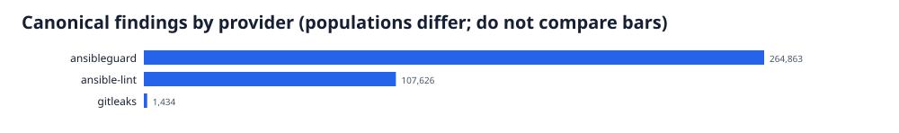

### 04-top-rules

Most frequent AnsibleGuard rules, all policies.

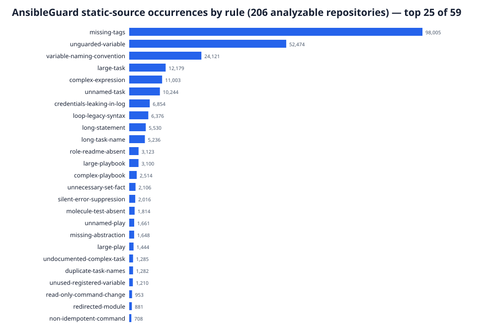

### 04b-top-required-rules

Most frequent AnsibleGuard rules, required occurrences only.

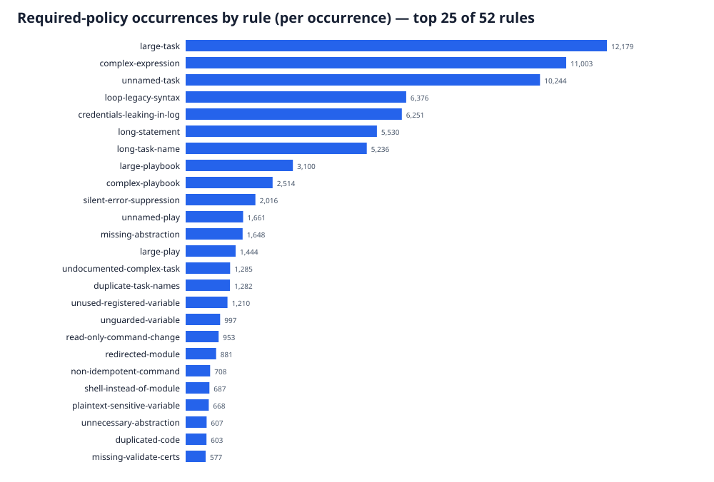

### 05-rule-prevalence

Share of analyzable repositories in which each rule fires.

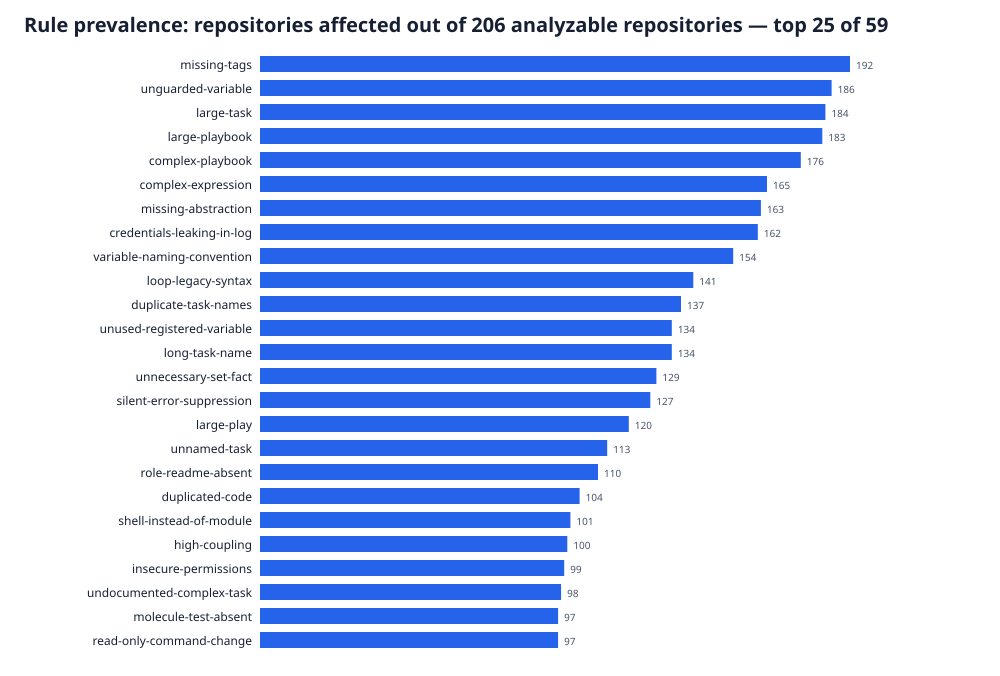

### 06-findings-per-repository-distribution

Distribution of AnsibleGuard occurrences per repository.

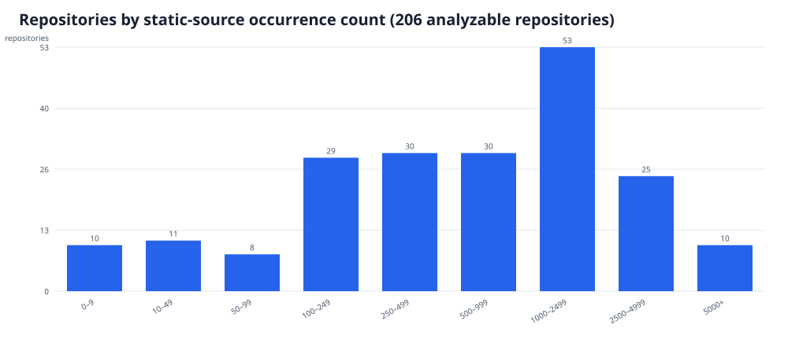

### 07-findings-density

Occurrences per 1,000 selected YAML lines, per repository.

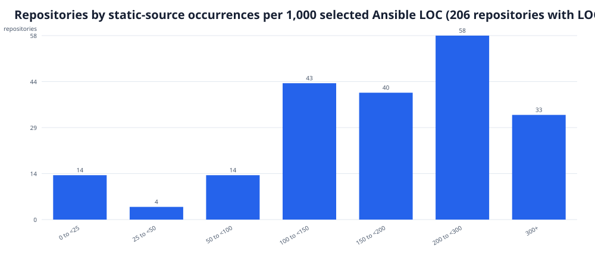

### 08-severity-distribution

Severity of AnsibleGuard occurrences.

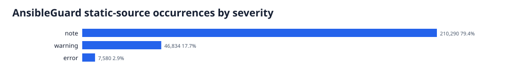

### 09-confidence-distribution

Detector confidence of AnsibleGuard occurrences.

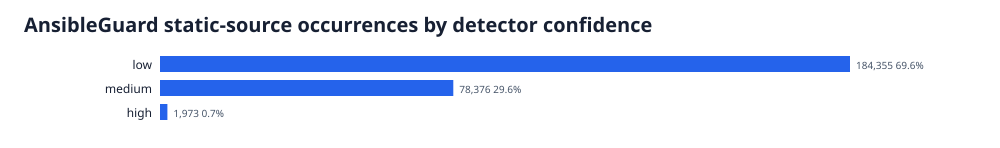

### 10-certainty-distribution

Certainty (confirmed, uncertain, exposed) of AnsibleGuard occurrences.

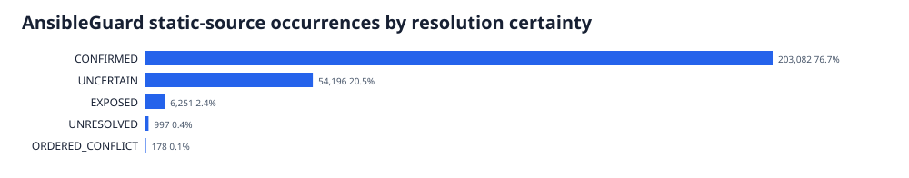

### 11-actionability-distribution

Actionability of AnsibleGuard occurrences.

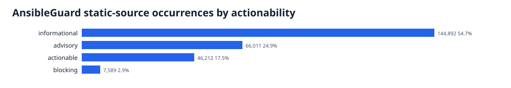

### 12-provider-completeness

Which providers completed per repository.

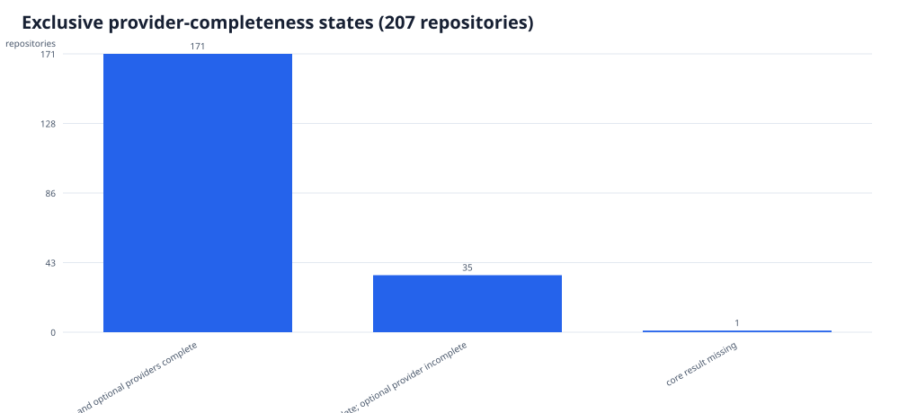

### 13-runtime-distribution

Scan time per repository (machine-dependent).

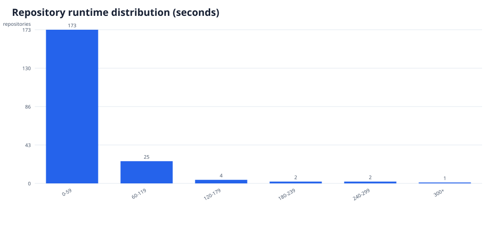

### 14-repository-size-vs-findings

Repository size (selected YAML lines) against occurrences.

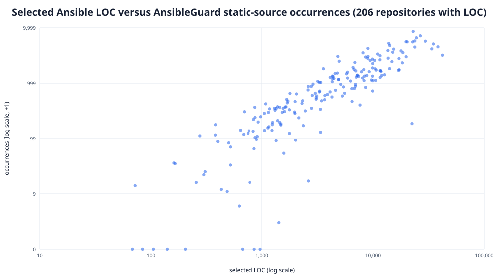

### 15-rule-repository-heatmap

Rule by repository heatmap.

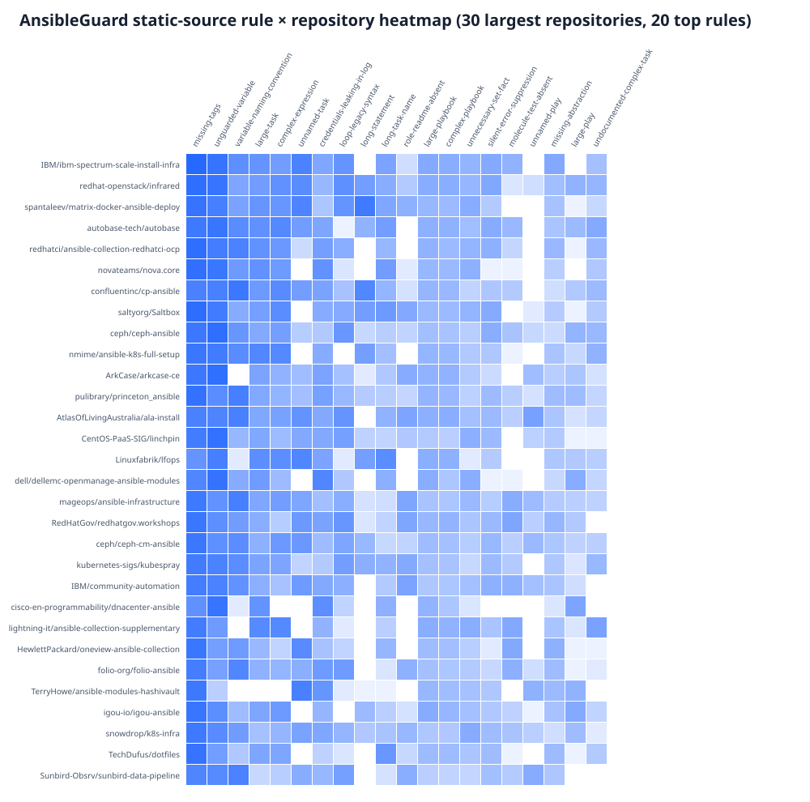

### 16-external-tool-overlap

Overlap with external tools (not modelled: no equivalence mapping).


The runner's own charts (same data, runner styling): [findings-by-category](../../study/analysis-v0071-rerun-2026-10-22/run/charts/findings-by-category.svg), [findings-by-certainty](../../study/analysis-v0071-rerun-2026-10-22/run/charts/findings-by-certainty.svg), [findings-by-provider](../../study/analysis-v0071-rerun-2026-10-22/run/charts/findings-by-provider.svg), [findings-by-severity](../../study/analysis-v0071-rerun-2026-10-22/run/charts/findings-by-severity.svg), [normalized-internal-findings-by-repository](../../study/analysis-v0071-rerun-2026-10-22/run/charts/normalized-internal-findings-by-repository.svg), [provider-completeness](../../study/analysis-v0071-rerun-2026-10-22/run/charts/provider-completeness.svg), [repository-category-heatmap](../../study/analysis-v0071-rerun-2026-10-22/run/charts/repository-category-heatmap.svg), [top-internal-concepts](../../study/analysis-v0071-rerun-2026-10-22/run/charts/top-internal-concepts.svg), [top-rules](../../study/analysis-v0071-rerun-2026-10-22/run/charts/top-rules.svg).

## 12. Comparison with earlier runs

Against `analysis-v0071-2026-10-16`: 59 of 59 rules have identical occurrence counts.

| Category | analysis-v0071-2026-10-16 | analysis-v0071-rerun-2026-10-22 | Change |
|---|---:|---:|---:|
| style | 148,846 | 148,846 | 0 |
| correctness | 53,603 | 53,603 | 0 |
| maintainability | 33,751 | 33,751 | 0 |
| security | 9,238 | 9,238 | 0 |
| compatibility | 7,257 | 7,257 | 0 |
| documentation | 5,084 | 5,084 | 0 |
| reliability | 2,976 | 2,976 | 0 |
| testing | 1,814 | 1,814 | 0 |
| structure | 1,686 | 1,686 | 0 |
| dependencies | 449 | 449 | 0 |

From v0.0.7 to v0.0.7.1 (the audit fixes), required counts changed for these rules (`rule-delta-vs-v007.csv`):

| Rule | v0.0.7 required | v0.0.7.1 required | Change |
|---|---:|---:|---:|
| non-idempotent-command | 1,476 | 708 | -768 |
| insecure-permissions | 450 | 422 | -28 |
| unused-handler | 29 | 8 | -21 |
| missing-file-extension | 14 | 2 | -12 |
| incomplete-task | 34 | 26 | -8 |
| missing-handler | 8 | 1 | -7 |
| invalid-task-attribute-type | 47 | 45 | -2 |
| broken-role-dependency | 1 | 0 | -1 |
| unscoped-shell-variable | 80 | 79 | -1 |
| read-only-command-change | 835 | 953 | 118 |

A decrease is not evidence of higher precision: it shows only that the audited false-positive mechanisms no longer fire.

## 13. Interpretation limits

- Counts are detector output. No precision or recall estimate exists until the human Reviewer A/B labels are adjudicated (`study/validation-v007-human/`).
- Uncertain occurrences depend on context the detector cannot see and must be kept separate from confirmed ones.
- Per-kLOC rates apply only to AnsibleGuard static-source and ansible-lint populations; GitLeaks scans whole repositories and review-only rules read Git history.
- ansible-lint results exist only for provider-complete repositories; cross-tool comparison uses those 171 only.
- Results describe the frozen selected repositories at their frozen commits and do not generalise beyond them.
- Repository concentration (Gini, top-repository share) means a few large repositories drive several rules' totals.

## 14. Files and reproduction

| What | Where |
|---|---|
| Analysis tables | `study/analysis-v0071-rerun-2026-10-22/*.csv` |
| Charts (SVG) and chart data | `study/analysis-v0071-rerun-2026-10-22/charts/` |
| Run reports, tables, status, environment | `study/analysis-v0071-rerun-2026-10-22/run/` |
| Full raw run archive | `~/Documents/AnsibleChecklist-results-2026-10-22/` (not in Git; checksum in `study/runs/*.sha256`) |

```bash
python scripts/v007_full_repro.py --config <config> --minimum-free-gib 20 --skip-benchmark-validation
python scripts/v007_full_repro.py --config <config> --postprocess-only   # after the single known timeout
python scripts/v007_results_analysis.py --run study/runs/<run-id> --output-dir study/analysis-v0071-rerun-2026-10-22
python scripts/v007_charts.py --run study/runs/<run-id> --output-dir study/analysis-v0071-rerun-2026-10-22/charts
python scripts/v007_charts_check.py study/runs/<run-id> study/analysis-v0071-rerun-2026-10-22/charts
python scripts/build_run_results_report.py --analysis <analysis-dir> --previous <earlier-analysis-dir> --output <report.md>
```
