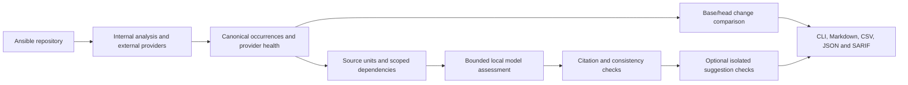

# Paper preparation: AnsibleGuard Tool Demonstration

Working title: **AnsibleGuard: Explaining Ansible Findings in Change-Aware Code Review**.
This is a writing package, not a completed manuscript or a release certification.
The current [engineering record](../../docs/study/icpc2027-tool-readiness-2026-11-10.md)
is authoritative for implementation details and outstanding gates.

## Four-page narrative

| Space | Content | Evidence required |
|---|---|---|
| 0.5 page | Developer problem: a finding needs source/scope context and a reviewer needs to know what changed | Concrete controlled demo, no asserted comprehension benefit |
| 1 page | Pipeline: providers, canonical occurrences, change matching, scoped evidence and bounded local assessment | Architecture and versioned contracts |
| 1 page | Walkthrough: scan, introduced TLS condition, inspect evidence and optional checked suggestion, runtime-input abstention | Reproducible CLI outputs; live LLM path still pending |
| 1 page | Maturity and bounded evaluation: engineering checks, fixed PR replays, reviewed case comparison | Frozen release logs and two-reviewer judgments; do not fill pending results with historical scores |
| 0.5 page | Limitations, availability, setup and future work | Public artifact access, dependency/model identities, current limitations |

Use the additional reference page for verified citations. Distinguish AnsibleGuard's
own behavior from integrated tools and prior empirical smell studies. The July
overlap audit is historical; current profiles and checksum behavior have changed.

## Claim-to-evidence ledger

| Proposed statement | Current evidence | Permitted use |
|---|---|---|
| Scans Ansible sources and integrates provider findings | Existing implementation and controlled demo with both providers complete | Describe implemented capability |
| Tracks introduced/fixed/moved findings | Matching regressions and frozen-pair replay harness | Functional claim; inspect new replay results and attribution before giving numbers |
| Retrieves task and scoped variable evidence | Packet fixtures, exact-span checks and source identities | Describe bounded mechanism and its limits |
| Local model explanations are grounded and useful | No current live V4 evaluation or human output reviews | Pending; do not assert measured benefit |
| Suggestions pass mechanical checks | Real isolated TLS check and automated regressions | State the checks, never behavioral preservation or guaranteed safe deployment |
| Improves over fixed windows | Paired evaluation runner exists; results pending | Hypothesis until reviewed results support it |
| Detector precision/recall or corpus defect prevalence | No new valid estimate | Exclude from this submission's results |
| Improves developer comprehension or saves time | No participant study | Exclude as an established result |

The comparison is between the complete fixed-window and scoped-evidence pipelines,
including bounded consistency checks. Separate backend rejections, model errors,
abstentions, citation membership, human entailment judgments, and wrong suggestions.
Do not treat a deterministic predicate check as independent model accuracy.

## Architecture figure source

## Recording script: approximately four minutes

1. **0:00–0:30 — Problem.** Show the two-commit fixture and explain the review
   question: which conditions did this change introduce, and what source supports
   them? The example URL is never contacted by static analysis.
2. **0:30–1:20 — Scan and comparison.** Run `scripts/run_icpc_demo.py` into a new
   output directory. Open the scan health summary, then the diff summary and
   introduced-only SARIF. Show provider health separately from finding severity.
3. **1:20–2:30 — Explain a TLS condition.** After explicit model setup is allowed,
   run the demo with `--explain`. Show the complete task, cited lines, condition,
   actionability, and source limitations. If a suggestion is present, show its
   mechanical-check record; it has not been applied to the repository.
4. **2:30–3:20 — Missing runtime evidence.** Show the separately recorded runtime
   input assessment. An unknown inventory/extra-vars value must not become a claim
   of certain runtime failure. Show abstention or a retained validation failure
   honestly; never edit a recording artifact into a successful result.
5. **3:20–4:00 — Availability and limits.** Show reproduction commands, release/model
   identities and review forms. Explain local-only inference and the limits of
   static checks and the small case evaluation.

If the live model cannot run reliably, use previously recorded, unedited output
from the exact frozen release, clearly labeled as recorded. There is currently
no V4 live recording to use. Do not publish a model-assisted demo as working until
that gate is actually completed.

## Review and release checklist

- Reviewers independently complete source forms before seeing model outputs.
- Freeze code/prompt/model/settings before running the evaluation panel.
- Preserve all attempts and both original reviewer forms; adjudicate separately.
- Review real PR introduced/fixed attribution independently of defect correctness.
- Prepare final checksums, wheel/source artifacts, figures and installation notes.
- Confirm public availability and license terms with the owner; do not invent a license.
- Verify author details, AI-use disclosure, current IEEE format, and submission metadata.
- The author submits the paper and publishes the recording; this work has not done so.
